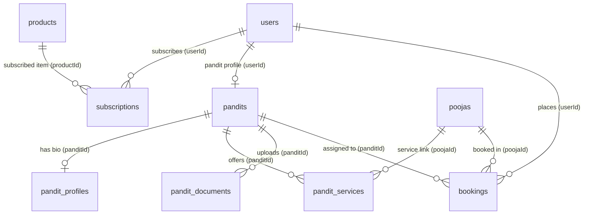
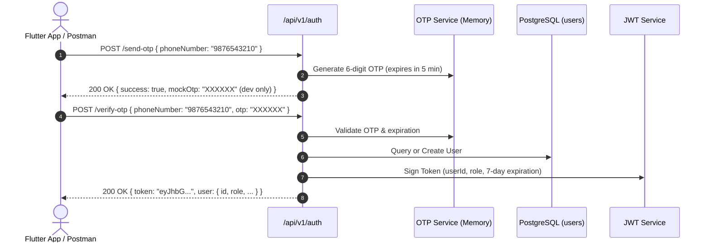
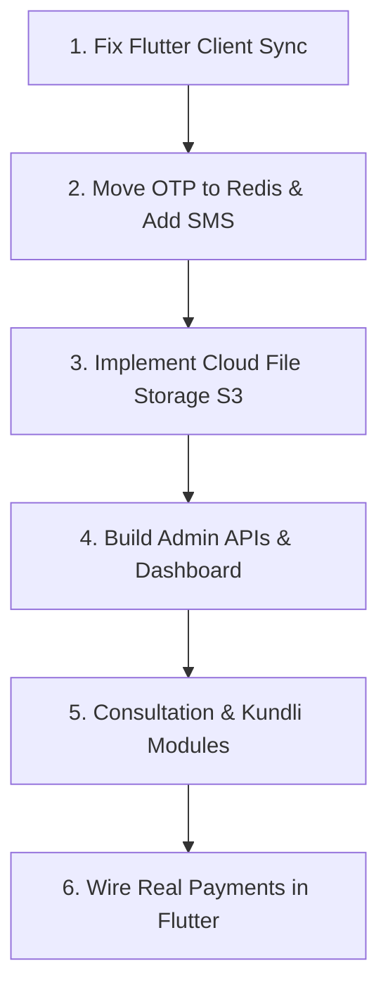

# Sarvmangal (Pandit Setu) — Backend Audit Report

**Date of Audit:** October 14, 2026  
**Auditor:** Antigravity Engineering & Architecture Review  
**Project Scope:** Backend infrastructure, database schemas, API layer, security posture, third-party integrations, and Flutter client synchronization.

---

## Table of Contents
1. [Backend Structure](#1-backend-structure)
2. [Backend Setup & Runnability](#2-backend-setup--runnability)
3. [Database Audit](#3-database-audit)
4. [Comprehensive API Audit](#4-comprehensive-api-audit)
5. [Authentication & Authorization](#5-authentication--authorization)
6. [Flutter ↔ Backend Connection Audit](#6-flutter--backend-connection-audit)
7. [Existing Integrations Audit](#7-existing-integrations-audit)
8. [Sarvmangal Requirements Gap Analysis](#8-sarvmangal-requirements-gap-analysis)
9. [Security Audit](#9-security-audit)
10. [Production Readiness Assessment](#10-production-readiness-assessment)
11. [Final Action Plan & Roadmap](#11-final-action-plan--roadmap)

---

## 1. Backend Structure

The backend is built as a modular RESTful API service located in the root repository folder, with all application code under [`src/`](file:///c:/Users/krmta/OneDrive/Desktop/pndtbcknd/src). It uses a clean layered architecture (Routes $\to$ Middleware $\to$ Controllers $\to$ Services $\to$ Database Schemas).

### Directory & Component Map

| Layer / Folder | Key Files & Paths | Purpose & Explanation in Simple Language |
| :--- | :--- | :--- |
| **Server Entry** | [`src/server.ts`](file:///c:/Users/krmta/OneDrive/Desktop/pndtbcknd/src/server.ts) | Starts the Node.js HTTP server on port 5000 (or custom `PORT`), binds the Socket.io WebSocket server, attaches the Redis socket adapter, and handles graceful shutdown signals (`SIGINT`, `SIGTERM`). |
| **Express App Config** | [`src/app.ts`](file:///c:/Users/krmta/OneDrive/Desktop/pndtbcknd/src/app.ts) | Initializes Express v5, configures global middlewares (Helmet for HTTP headers, CORS, body parsers, IP rate limiting), mounts all API route handlers under `/api/v1`, and registers global 404 and 500 error handlers. |
| **Configuration & Env** | [`src/config/index.ts`](file:///c:/Users/krmta/OneDrive/Desktop/pndtbcknd/src/config/index.ts) | Validates environment variables at boot time using **Zod**. If a critical variable (such as `DATABASE_URL` or `JWT_SECRET`) is missing, it crashes immediately with a readable error message instead of failing silently later. |
| **Routing Layer** | [`src/routes/`](file:///c:/Users/krmta/OneDrive/Desktop/pndtbcknd/src/routes) | Maps incoming HTTP URL paths and methods (e.g., `POST /api/v1/auth/send-otp`) to specific controllers and validation middleware. |
| **Controllers Layer** | [`src/controllers/`](file:///c:/Users/krmta/OneDrive/Desktop/pndtbcknd/src/controllers) | Extracts incoming HTTP requests, headers, and body parameters, calls the relevant business service, and sends the HTTP response back to the user with standard status codes. |
| **Services Layer** | [`src/services/`](file:///c:/Users/krmta/OneDrive/Desktop/pndtbcknd/src/services) | Contains the actual business logic (e.g., generating OTPs, verifying signatures, calculating geospatial distances, processing payments, signing JWTs). |
| **Database & Models** | [`src/db/`](file:///c:/Users/krmta/OneDrive/Desktop/pndtbcknd/src/db)<br>[`src/db/schema/`](file:///c:/Users/krmta/OneDrive/Desktop/pndtbcknd/src/db/schema) | Sets up the PostgreSQL connection pool using `pg` and defines table schemas with types, foreign keys, and PostGIS geospatial columns using **Drizzle ORM**. |
| **Migrations** | [`drizzle/`](file:///c:/Users/krmta/OneDrive/Desktop/pndtbcknd/drizzle)<br>[`drizzle.config.ts`](file:///c:/Users/krmta/OneDrive/Desktop/pndtbcknd/drizzle.config.ts) | Holds SQL migration files (`0000_init_schema.sql` through `0005_...sql`) and the Drizzle Kit CLI configuration for database migrations and schema synchronization. |
| **Middleware** | [`src/middleware/`](file:///c:/Users/krmta/OneDrive/Desktop/pndtbcknd/src/middleware) | Intercepts requests before they reach controllers. Includes authentication check (`authenticate`), role authorization (`authorize`), request body validation (`validate`), rate limiting, and error handling. |
| **Utilities & Helpers** | [`src/utils/logger.ts`](file:///c:/Users/krmta/OneDrive/Desktop/pndtbcknd/src/utils/logger.ts)<br>[`src/utils/errors.ts`](file:///c:/Users/krmta/OneDrive/Desktop/pndtbcknd/src/utils/errors.ts) | Custom Winston logger with colorized console logs and standard API error classes (`AppError`, `NotFoundError`, `UnauthorizedError`, `ValidationError`). |

---

## 2. Backend Setup & Runnability

- **Node.js & TypeScript:** Fully configured. Uses modern ES Modules (`"type": "module"` in [`package.json`](file:///c:/Users/krmta/OneDrive/Desktop/pndtbcknd/package.json)). TypeScript 5.8.3 is configured via [`tsconfig.json`](file:///c:/Users/krmta/OneDrive/Desktop/pndtbcknd/tsconfig.json) with strict type checking enabled (`"strict": true`).
- **Express Configuration:** Uses Express **v5.1.0** with native async/await error handling.
- **Backend Startup Command:**
  - **Development Mode:** `npm run dev`  
    *(Runs `tsx watch --env-file=.env src/server.ts` which automatically reloads on code edits).*
  - **Production Mode:** `npm run build` followed by `npm start`  
    *(Compiles TypeScript to JavaScript into `dist/` and runs `node dist/src/server.js`).*
- **Is the backend actually runnable?** **YES.**  
  The background process runs cleanly on `http://localhost:5000`. The server boots cleanly, logs database connection status, and binds Socket.io.
- **Available Scripts:**
  - `npm run build`: Compiles TypeScript with `tsconfig.build.json`.
  - `npm run typecheck`: Validates all TypeScript types (`tsc --noEmit`).
  - `npm run test`: Runs test suite using Vitest.
  - `npm run db:generate`: Generates SQL migrations from Drizzle schemas.
  - `npm run db:migrate`: Executes pending SQL migrations on PostgreSQL.
  - `npm run db:push`: Direct schema push without migration files.
  - `npm run db:studio`: Starts Drizzle Studio web GUI for inspecting rows.
- **Configuration Problems & Missing Setup:**
  1. **In-Memory OTP Fallback:** The backend stores OTPs in an in-memory `Map` rather than Redis. When the server restarts or scales to multiple processes, stored OTPs vanish.
  2. **Development Bypass Active:** In development mode (`NODE_ENV=development`), OTPs are logged directly to the console and returned in the HTTP response (`res.body.mockOtp`). A real SMS gateway (Twilio/MSG91/Fast2SMS) is not plugged in.
  3. **File Upload Storage:** Local filesystem storage is used (`uploads/` directory). There is no cloud bucket (AWS S3 / Google Cloud Storage / Cloudinary) configured for persistent media storage.

---

## 3. Database Audit

### Database Technology & ORM
- **Database Engine:** PostgreSQL with **PostGIS** extension (`CREATE EXTENSION IF NOT EXISTS postgis;`).
- **ORM:** **Drizzle ORM** (`drizzle-orm` v0.44.2 + `drizzle-kit` v0.31.4). Drizzle is **fully implemented and actively used**, not just listed in `package.json`.
- **Connection Configuration:** Located in [`src/db/index.ts`](file:///c:/Users/krmta/OneDrive/Desktop/pndtbcknd/src/db/index.ts). It creates a PostgreSQL connection pool (`pg.Pool`) using the `DATABASE_URL` environment variable.

### Existing Tables & Schema Definitions

All table models are defined in [`src/db/schema/`](file:///c:/Users/krmta/OneDrive/Desktop/pndtbcknd/src/db/schema):

```
src/db/schema/
├── users.ts               -> users table (authentication, roles, profile)
├── pandits.ts             -> pandits table (experience, PostGIS location point, verification status)
├── pandit_documents.ts   -> pandit_documents table (ID proof, address proof, certificates)
├── pandit_profiles.ts    -> pandit_profiles table (bio, specializations, languages, photo)
├── pandit_services.ts    -> pandit_services table (junction linking pandits to specific poojas)
├── poojas.ts              -> poojas catalog (name, duration, base price, materials)
├── products.ts            -> e-commerce items (samagri, havan wood, incense, stock)
├── bookings.ts            -> pooja bookings (user, pandit, pooja, status, PostGIS location)
└── subscriptions.ts       -> recurring subscriptions (daily/weekly flower & samagri delivery)
```

### Table Relationships & Data Integrity



- **Users $\to$ Pandits:** One-to-One. A user with role `pandit` has an associated record in `pandits` linked by `userId`.
- **Pandits $\to$ Documents:** One-to-Many. Linked by `panditId`. Holds URLs and verification status (`pending`, `verified`, `rejected`).
- **Pandits $\to$ Services:** Many-to-Many junction between `pandits` and `poojas`, allowing individual pandits to customize their offerings and custom pricing.
- **Bookings:** Foreign keys to `users(id)`, `pandits(id)`, and `poojas(id)`.
- **Subscriptions:** Foreign keys to `users(id)` and `products(id)`.

### Migrations Status
- Migrations are fully configured in [`drizzle.config.ts`](file:///c:/Users/krmta/OneDrive/Desktop/pndtbcknd/drizzle.config.ts) and output to [`drizzle/`](file:///c:/Users/krmta/OneDrive/Desktop/pndtbcknd/drizzle).
- Six migration steps have been generated:
  1. `0000_init_schema.sql`: Sets up PostGIS, initial tables, and spatial GIST indexes.
  2. `0001_add_roles_and_indexes.sql`: Adds indexes on `phone_number` and `role`.
  3. `0002_add_pandit_services_and_profiles.sql`: Adds profile details and custom service pricing.
  4. `0003_add_payment_status_and_booking_number.sql`: Adds order tracking columns.
  5. `0004_fix_subscriptions_schema.sql`: Normalizes subscription intervals.
  6. `0005_add_is_active_to_products.sql`: Soft deletion flag for e-commerce products.

### Database Connection & Errors
- The database connection is operational when a valid PostgreSQL instance with PostGIS is supplied via `.env`.
- **Requirement:** PostGIS must be installed on the PostgreSQL server. If standard vanilla PostgreSQL without PostGIS is used, migration `0000` will fail on `CREATE EXTENSION postgis;`.

---

## 4. Comprehensive API Audit

Below is the verified audit of every registered endpoint in the Express router tree:

| HTTP Method | Endpoint | Purpose | Auth Required | Role Required | Controller / Service | DB Interaction | Current Status |
| :--- | :--- | :--- | :--- | :--- | :--- | :--- | :--- |
| `POST` | `/api/v1/auth/send-otp` | Sends numeric OTP to user's mobile number | None | Any | [`AuthController.sendOtp`](file:///c:/Users/krmta/OneDrive/Desktop/pndtbcknd/src/controllers/auth.controller.ts) | Queries `users` to check if user exists | **Implemented** *(Uses mock OTP in dev; in-memory store)* |
| `POST` | `/api/v1/auth/verify-otp` | Verifies OTP, creates user if new, generates JWT | None | Any | [`AuthController.verifyOtp`](file:///c:/Users/krmta/OneDrive/Desktop/pndtbcknd/src/controllers/auth.controller.ts) | Inserts or updates `users` | **Implemented** |
| `GET` | `/api/v1/users/me` | Fetches current logged-in user profile | Bearer JWT | Any | [`UsersController.getProfile`](file:///c:/Users/krmta/OneDrive/Desktop/pndtbcknd/src/controllers/users.controller.ts) | Reads `users` by ID | **Implemented** |
| `PUT` | `/api/v1/users/me` | Updates name and email | Bearer JWT | Any | [`UsersController.updateProfile`](file:///c:/Users/krmta/OneDrive/Desktop/pndtbcknd/src/controllers/users.controller.ts) | Updates `users` table | **Implemented** |
| `POST` | `/api/v1/pandits/register` | Onboards pandit (city, experience, lat/lng) | Bearer JWT | `pandit` or `yajman` | [`PanditsController.register`](file:///c:/Users/krmta/OneDrive/Desktop/pndtbcknd/src/controllers/pandits.controller.ts) | Inserts into `pandits`, updates `users.role` | **Implemented** |
| `GET` | `/api/v1/pandits/nearby` | Finds pandits near coordinates using PostGIS | Optional JWT | Any | [`PanditsController.getNearby`](file:///c:/Users/krmta/OneDrive/Desktop/pndtbcknd/src/controllers/pandits.controller.ts) | PostGIS `ST_DWithin` spatial query on `pandits` | **Implemented** *(Fails if `lat`/`lng` query params omitted)* |
| `GET` | `/api/v1/pandits/:id` | Gets pandit public profile & services | Optional JWT | Any | [`PanditsController.getById`](file:///c:/Users/krmta/OneDrive/Desktop/pndtbcknd/src/controllers/pandits.controller.ts) | Reads `pandits`, `pandit_profiles`, `pandit_services` | **Implemented** |
| `PUT` | `/api/v1/pandits/:id/status`| Approves or rejects pandit verification | Bearer JWT | `admin` | [`PanditsController.updateStatus`](file:///c:/Users/krmta/OneDrive/Desktop/pndtbcknd/src/controllers/pandits.controller.ts) | Updates `pandits.status` | **Implemented** |
| `POST` | `/api/v1/pandits/documents`| Uploads verification document (Aadhaar/Cert) | Bearer JWT | `pandit` | [`PanditsController.uploadDoc`](file:///c:/Users/krmta/OneDrive/Desktop/pndtbcknd/src/controllers/pandits.controller.ts) | Inserts record into `pandit_documents` | **Implemented** *(Stores on local disk)* |
| `GET` | `/api/v1/poojas` | Lists available poojas in catalog | None | Public | [`PoojasController.getAll`](file:///c:/Users/krmta/OneDrive/Desktop/pndtbcknd/src/controllers/poojas.controller.ts) | Reads active rows from `poojas` | **Implemented** |
| `GET` | `/api/v1/poojas/:id` | Gets details of a specific pooja | None | Public | [`PoojasController.getById`](file:///c:/Users/krmta/OneDrive/Desktop/pndtbcknd/src/controllers/poojas.controller.ts) | Reads single row from `poojas` | **Implemented** |
| `POST` | `/api/v1/poojas` | Creates a new pooja category/service | Bearer JWT | `admin` | [`PoojasController.create`](file:///c:/Users/krmta/OneDrive/Desktop/pndtbcknd/src/controllers/poojas.controller.ts) | Inserts into `poojas` | **Implemented** |
| `POST` | `/api/v1/bookings` | Creates a new puja booking | Bearer JWT | `yajman` | [`BookingsController.create`](file:///c:/Users/krmta/OneDrive/Desktop/pndtbcknd/src/controllers/bookings.controller.ts) | Inserts into `bookings`, notifies via Socket.io | **Implemented** *(Strict Zod schema)* |
| `GET` | `/api/v1/bookings/my-bookings`| Retrieves booking history for logged-in user | Bearer JWT | Any | [`BookingsController.getUserBookings`](file:///c:/Users/krmta/OneDrive/Desktop/pndtbcknd/src/controllers/bookings.controller.ts) | Queries `bookings` where `userId = user.id` | **Implemented** |
| `GET` | `/api/v1/bookings/:id` | Retrieves single booking details | Bearer JWT | Any | [`BookingsController.getById`](file:///c:/Users/krmta/OneDrive/Desktop/pndtbcknd/src/controllers/bookings.controller.ts) | Queries `bookings` | **Implemented** |
| `PUT` | `/api/v1/bookings/:id/status`| Updates booking status (`accepted`, `completed`)| Bearer JWT | `pandit`/`admin` | [`BookingsController.updateStatus`](file:///c:/Users/krmta/OneDrive/Desktop/pndtbcknd/src/controllers/bookings.controller.ts) | Updates `bookings.status` | **Implemented** |
| `GET` | `/api/v1/products` | Lists e-commerce items for samagri shop | None | Public | [`ProductsController.getAll`](file:///c:/Users/krmta/OneDrive/Desktop/pndtbcknd/src/controllers/products.controller.ts) | Reads active rows from `products` | **Implemented** |
| `POST` | `/api/v1/products` | Adds an item to the e-commerce store | Bearer JWT | `admin` | [`ProductsController.create`](file:///c:/Users/krmta/OneDrive/Desktop/pndtbcknd/src/controllers/products.controller.ts) | Inserts into `products` | **Implemented** |
| `POST` | `/api/v1/subscriptions` | Creates daily/weekly flower/mala subscription | Bearer JWT | `yajman` | [`SubscriptionsController.create`](file:///c:/Users/krmta/OneDrive/Desktop/pndtbcknd/src/controllers/subscriptions.controller.ts) | Inserts into `subscriptions` | **Implemented** |
| `GET` | `/api/v1/subscriptions/my` | Retrieves current user subscriptions | Bearer JWT | `yajman` | [`SubscriptionsController.getUserSubs`](file:///c:/Users/krmta/OneDrive/Desktop/pndtbcknd/src/controllers/subscriptions.controller.ts) | Reads `subscriptions` by `userId` | **Implemented** |
| `POST` | `/api/v1/payments/create-order`| Creates Razorpay order for booking payment | Bearer JWT | Any | [`PaymentsController.createOrder`](file:///c:/Users/krmta/OneDrive/Desktop/pndtbcknd/src/controllers/payments.controller.ts) | Calls Razorpay API; reads booking | **Implemented** |
| `POST` | `/api/v1/payments/verify` | Verifies Razorpay payment signature | Bearer JWT | Any | [`PaymentsController.verifyPayment`](file:///c:/Users/krmta/OneDrive/Desktop/pndtbcknd/src/controllers/payments.controller.ts) | Updates `bookings.paymentStatus` | **Implemented** |
| `POST` | `/api/v1/payments/webhook` | Webhook handler for payment confirmation | Signature Header| Webhook | [`PaymentsController.handleWebhook`](file:///c:/Users/krmta/OneDrive/Desktop/pndtbcknd/src/controllers/payments.controller.ts) | Updates booking payment status in DB | **Implemented** |
| `GET` | `/api/v1/temples/nearby` | Finds nearby temples via Google Places API | None | Public | [`TemplesController.getNearby`](file:///c:/Users/krmta/OneDrive/Desktop/pndtbcknd/src/controllers/temples.controller.ts) | Calls Google Places API + Redis caching | **Implemented** |
| `GET` | `/api/v1/admin/health` | Backend system health check for admins | Bearer JWT | `admin` | Inline Controller in [`admin.routes.ts`](file:///c:/Users/krmta/OneDrive/Desktop/pndtbcknd/src/routes/admin.routes.ts) | DB ping | **Implemented** |

---

## 5. Authentication & Authorization

### What Exists & How It Works



- **Registration & Login:** Unified passwordless flow via mobile number + OTP. If a user does not exist upon OTP verification, a record is automatically created in `users` with the default role `yajman`.
- **OTP Generation & Verification:** Managed by [`src/services/otp.service.ts`](file:///c:/Users/krmta/OneDrive/Desktop/pndtbcknd/src/services/otp.service.ts). In development mode, the OTP is printed in the terminal logs and returned in the HTTP response body for automated testing.
- **Password Handling:** There are **no passwords**. The system exclusively uses OTP-based authentication.
- **JWT / Session:** Implemented in [`src/services/jwt.service.ts`](file:///c:/Users/krmta/OneDrive/Desktop/pndtbcknd/src/services/jwt.service.ts) using `jsonwebtoken`. Generates an Access Token with a 7-day lifespan containing `{ userId, role }`.
- **Refresh Tokens:** **Not implemented.** There is no refresh token table, no token rotation, and no `/auth/refresh` endpoint.
- **Logout:** **Not implemented on backend.** No token blacklist or revocation exists; logout currently relies solely on the client discarding its stored JWT.
- **Role-Based Access Control (RBAC):** Implemented in [`src/middleware/auth.ts`](file:///c:/Users/krmta/OneDrive/Desktop/pndtbcknd/src/middleware/auth.ts).
  - Supported roles: `yajman`, `pandit`, `admin`.
  - Routes protected by `authorize(['admin'])` reject non-admins with HTTP 403 Forbidden.
  - Routes protected by `authorize(['pandit', 'admin'])` reject yajmans.

### Genuinely Working vs. Partially Implemented Auth

| Feature | Status | Notes |
| :--- | :--- | :--- |
| Mobile OTP Generation | **Working** | Works with in-memory store; does not persist across server reboots. |
| Real SMS Delivery | **Missing** | Console log only; needs integration with Twilio/Fast2SMS/MSG91. |
| JWT Issuance & Verification | **Working** | Validated on protected endpoints via `Authorization: Bearer <token>`. |
| Refresh Tokens | **Missing** | Expired tokens force users to re-authenticate with OTP. |
| Token Revocation / Blacklist | **Missing** | Tokens remain valid until their 7-day expiration time. |
| Role Restriction | **Working** | Middleware strictly blocks unauthorized roles. |

---

## 6. Flutter ↔ Backend Connection Audit

An audit of [`frontend/pandit_ssetu/lib/services/api_service.dart`](file:///c:/Users/krmta/OneDrive/Desktop/pndtbcknd/frontend/pandit_ssetu/lib/services/api_service.dart) reveals a **major disconnect** between the Flutter mobile app and the Node.js backend.

### 1. Base API URL & Networking
- In Flutter, `baseUrl` is hardcoded as:
  ```dart
  static const String baseUrl = 'http://localhost:5000/api/v1';
  ```
- **Why this fails on physical devices & Android Emulators:**  
  On an Android Emulator, `localhost` points to the emulator itself, not your host PC (the Android emulator requires `http://10.0.2.2:5000/api/v1`). On a physical phone, it requires your computer's local Wi-Fi IP address (e.g., `http://192.168.1.X:5000/api/v1`).

### 2. Broken & Mismatched API Calls

| Flutter Method | URL Called by Flutter | Actual Backend URL | Result / Why it Fails |
| :--- | :--- | :--- | :--- |
| `getProfile()` | `GET /auth/profile` | `GET /users/me` | **Fails with HTTP 404 Not Found.** The backend route is `/users/me`, but Flutter requests `/auth/profile`. |
| `createBooking()` | `POST /bookings` | `POST /bookings` | **Fails with HTTP 400 Bad Request.** Flutter sends: `{ poojaId, bookingDate, bookingTime, bookingType, address, totalAmount }`. The backend's Zod schema strictly requires `{ poojaId, date, time, location, latitude, longitude, materialsIncluded }`. |
| `createBooking()` fallback | *N/A (Local catch)* | *None* | Upon receiving the HTTP 400 error, Flutter catches the exception and saves a mock booking into phone storage (`SharedPreferences`). The user thinks the booking succeeded, but the backend database has no record of it. |
| `getNearbyPandits()` | `GET /pandits/nearby` | `GET /pandits/nearby?lat=...&lng=...&radiusKm=...` | **Fails with HTTP 400.** When called without coordinates, backend validation rejects it. Flutter catches the error and displays a hardcoded static list of pandits. |

### 3. Screens Completely Disconnected from Backend

- **Samagri Shop ([`ShopScreen`](file:///c:/Users/krmta/OneDrive/Desktop/pndtbcknd/frontend/pandit_ssetu/lib/screens/shop_screen.dart)):** Reads exclusively from a bundled local file (`assets/data/products.json`). It never makes an HTTP call to `GET /api/v1/products`.
- **Pandit Login Screen:** Hardcoded check for dummy OTP `123456`. It does not make any network call to `/api/v1/auth/send-otp` or `/api/v1/auth/verify-otp`.
- **Pandit Duty Dashboard ([`PanditDashboardScreen`](file:///c:/Users/krmta/OneDrive/Desktop/pndtbcknd/frontend/pandit_ssetu/lib/screens/pandit_dashboard_screen.dart)):** The online/offline toggle updates an in-memory boolean in Flutter state; it never calls any backend endpoint to update availability in the database.
- **Admin Dashboard:** There is no Admin screen in the Flutter client.

---

## 7. Existing Integrations Audit

| Integration Service | Status | Evidence in Codebase |
| :--- | :--- | :--- |
| **Redis** | **Partially Implemented** | Integrated in [`src/db/redis.ts`](file:///c:/Users/krmta/OneDrive/Desktop/pndtbcknd/src/db/redis.ts) for geohashed temple query caching and Socket.io adapter. However, it is **not** used for OTP storage or session management. |
| **Socket.IO** | **Partially Implemented** | Backend server binds Socket.io in [`src/server.ts`](file:///c:/Users/krmta/OneDrive/Desktop/pndtbcknd/src/server.ts) and emits `booking:created` events. However, the Flutter client has **no Socket.io client package** installed and never connects. |
| **Razorpay** | **Partially Implemented** | Backend has complete order generation and HMAC SHA256 webhook signature validation in [`src/services/payments.service.ts`](file:///c:/Users/krmta/OneDrive/Desktop/pndtbcknd/src/services/payments.service.ts). However, Flutter has no Razorpay SDK installed and never calls the checkout sheet. |
| **Agora Video Calling** | **Partially Implemented** | Backend has RTC token generation in [`src/services/agora.service.ts`](file:///c:/Users/krmta/OneDrive/Desktop/pndtbcknd/src/services/agora.service.ts). However, the Flutter app has no Agora SDK integrated; video puja displays a static simulated UI. |
| **Firebase / Push Notifications** | **Partially Implemented** | Backend has an FCM sending utility in [`src/services/notification.service.ts`](file:///c:/Users/krmta/OneDrive/Desktop/pndtbcknd/src/services/notification.service.ts) using `firebase-admin`. However, Flutter lacks `firebase_core` and `firebase_messaging` to receive tokens or push notifications. |
| **Google Places API** | **Implemented (Backend)** | [`src/services/temples.service.ts`](file:///c:/Users/krmta/OneDrive/Desktop/pndtbcknd/src/services/temples.service.ts) queries the Google Places API for nearby temples and caches responses in Redis. Flutter does not currently display this data. |
| **File / Media Storage** | **Partially Implemented** | Uses local disk storage (`multer` writing to `uploads/`). No AWS S3, Google Cloud Storage, or Cloudinary integration exists. Files will not persist in containerized/cloud deployments. |
| **SMS / OTP Provider** | **Not Implemented** | [`src/services/sms.service.ts`](file:///c:/Users/krmta/OneDrive/Desktop/pndtbcknd/src/services/sms.service.ts) contains a stub that logs OTPs to the console. No provider (Twilio, MSG91, Fast2SMS) is integrated. |
| **AI APIs (Gemini/OpenAI)** | **Not Implemented** | The Flutter app's "AI Jyotish" feature uses client-side `if/else` keyword matching. No backend AI service or LLM API integration exists. |
| **Google Meet** | **Not Implemented** | No Google Calendar or Google Meet API code exists. |
| **Email Service** | **Not Implemented** | No Nodemailer, SendGrid, or Resend integration exists. |
| **Maps & Location Services** | **Partially Implemented** | PostGIS database queries exist for nearby calculations, but no Google Maps routing or distance-matrix service is integrated. |

---

## 8. Sarvmangal Requirements Gap Analysis

### Yajman (Customer) Features

| Feature | Backend Status | Implementation Details / Gaps |
| :--- | :--- | :--- |
| Yajman Authentication | **READY** | Full OTP verification and JWT issuance functional via `/auth/*`. |
| Puja Booking (General) | **READY** | `POST /bookings` handles creation, status tracking, and database persistence. |
| Online Puja (Video) | **PARTIAL** | Agora token generation exists on backend, but meeting room lifecycle is missing. |
| Offline Puja (In-Person) | **READY** | Supported via booking address and PostGIS coordinates. |
| Manual Pandit Selection | **READY** | Supported; `POST /bookings` accepts an explicit `panditId`. |
| Automatic Nearby Selection | **PARTIAL** | PostGIS proximity search exists (`/pandits/nearby`), but auto-assignment queue logic is missing. |
| Date & Time Selection | **READY** | Validated and stored in `bookings.date` and `bookings.time`. |
| Location Selection | **READY** | Validated and stored as text address + PostGIS geometry point. |
| Samagri Inclusion/Exclusion | **READY** | Supported via boolean flag `materialsIncluded` in `bookings` table. |
| Astrology Consultation | **MISSING** | No consultation schema, astrologer slots, or consultation booking routes exist. |
| Immediate Consultation | **MISSING** | No on-demand queuing or WebRTC instant matching service exists. |
| Scheduled Consultation | **MISSING** | No calendar availability slot system exists in the database. |
| 15/30/60 Min Duration Pricing| **MISSING** | No dynamic duration-based pricing calculation exists. |
| Phone / Online Meeting Link | **PARTIAL** | Agora token exists; telephony/VoIP or Google Meet links are not implemented. |
| Handmade Kundli Service | **MISSING** | No schema, endpoints, or workflow for Kundli document generation or dispatch. |
| Flower / Mala Subscription | **READY** | `subscriptions` table and `POST /subscriptions` route are functional. |
| Daily Product Purchase | **READY** | `products` table and `GET /products` catalog endpoint are functional. |
| Instant Delivery Tracking | **MISSING** | No delivery partner assignment, tracking coordinates, or dispatch API exists. |
| AI Spiritual Chat | **MISSING** | No backend LLM integration (OpenAI/Gemini) exists. |
| Push Notifications | **PARTIAL** | Backend FCM service exists; needs real Firebase credentials and device token registration endpoint. |
| Payments (Razorpay) | **READY** | Order creation and webhook verification functional on backend; needs Flutter SDK hookup. |

---

### Pandit Features

| Feature | Backend Status | Implementation Details / Gaps |
| :--- | :--- | :--- |
| Phone Authentication | **READY** | Same OTP authentication pipeline as Yajmans (`/auth/*`). |
| Bank Details Onboarding | **MISSING** | No bank account, IFSC code, or UPI ID columns in `pandits` schema. |
| Document Verification | **READY** | `pandit_documents` table supports Aadhaar/certificate uploads via `POST /pandits/documents`. |
| 30-Second Intro Video | **MISSING** | No video upload endpoint or video streaming storage exists. |
| Admin Verification Workflow | **READY** | `PUT /pandits/:id/status` allows admins to approve or reject pandits. |
| Pandit Access After Approval | **READY** | Enforced via status check in middleware (`approved` vs. `pending`). |
| Receive Booking Requests | **PARTIAL** | Emits Socket.io event; lacks pandit-specific pending request inbox API. |
| Accept / Reject Booking | **READY** | `PUT /bookings/:id/status` allows pandits to accept or decline. |
| Pandit Availability Toggle | **PARTIAL** | `isActive` column exists in `pandits` table, but dedicated toggle endpoint is missing. |
| Consultation Assignment | **MISSING** | No consultation assignment logic exists. |

---

### Admin Features

| Feature | Backend Status | Implementation Details / Gaps |
| :--- | :--- | :--- |
| Admin Dashboard Overview | **MISSING** | Only `GET /admin/health` exists; no statistics or revenue aggregation endpoints. |
| Yajman Management | **MISSING** | No user management endpoints (listing, blocking, viewing history). |
| Pandit Management | **PARTIAL** | Single pandit approval endpoint exists; no admin pandit list with filters. |
| Pandit Verification View | **PARTIAL** | Can view documents via URL; no admin review queue API. |
| Puja Catalog Management | **READY** | `POST /poojas` allows admins to add new pujas to the catalog. |
| Booking Management | **PARTIAL** | Can update single booking status; no global booking list for admins. |
| Pandit Manual Assignment | **MISSING** | No endpoint allows an admin to reassign a booking to a different pandit. |
| Product Management | **READY** | `POST /products` allows admins to add items to the store. |
| Flower/Mala Management | **PARTIAL** | Handled through general product endpoints; no specific subscription catalog management. |
| Kundli Management | **MISSING** | No Kundli-related endpoints exist. |
| Consultation Management | **MISSING** | No consultation endpoints exist. |
| Banner / Ad Management | **MISSING** | No banner schema or CMS endpoints exist. |
| Payment Management | **PARTIAL** | Razorpay webhooks process payments, but no admin transaction ledger API exists. |
| Expense Management | **MISSING** | No financial ledger or expense tracking tables exist. |
| Broadcast Notifications | **MISSING** | No admin broadcast notification endpoint exists. |
| Analytics & Reports | **MISSING** | No PDF/Excel report generation or analytics aggregation queries exist. |

---

## 9. Security Audit

> [!CAUTION]
> Below are the identified security risks in the current codebase. Specific secret strings and credentials have been omitted in compliance with security guidelines.

1. **Exposed Credentials in `.env` File:**
   - A `.env` file exists in the project root directory. It contains active connection strings and secrets, including database connection strings, JWT secrets, Razorpay API credentials, and Google Places API keys.
   - **Risk:** If this `.env` file is accidentally committed to a public Git repository, all connected services will be compromised.
   - **Remedy:** Ensure `.env` is listed in [`.gitignore`](file:///c:/Users/krmta/OneDrive/Desktop/pndtbcknd/.gitignore). Create a `.env.example` template containing variable names with blank values.

2. **Permissive Cross-Origin Resource Sharing (CORS):**
   - In [`src/app.ts`](file:///c:/Users/krmta/OneDrive/Desktop/pndtbcknd/src/app.ts), the CORS configuration is set as:
     ```typescript
     cors({ origin: config.CORS_ORIGIN, credentials: true })
     ```
   - In `.env`, `CORS_ORIGIN` is configured as `*` (wildcard). Combining `origin: '*'` with `credentials: true` violates modern browser security policies and allows arbitrary websites to make authenticated requests if credentials are used.
   - **Remedy:** Restrict `CORS_ORIGIN` to specific trusted domains.

3. **In-Memory OTP Storage Vulnerability:**
   - In [`src/services/otp.service.ts`](file:///c:/Users/krmta/OneDrive/Desktop/pndtbcknd/src/services/otp.service.ts), OTPs are stored in an in-memory JavaScript `Map`.
   - **Risk:** 
     - Memory leak: Old records are not evicted unless checked.
     - Multi-instance failure: In a load-balanced environment with multiple server processes, an OTP requested on Instance A cannot be verified on Instance B.
   - **Remedy:** Move OTP storage to Redis with an automatic Time-To-Live (TTL) of 300 seconds.

4. **Hardcoded Fallback Secrets in Code:**
   - In [`src/services/payments.service.ts`](file:///c:/Users/krmta/OneDrive/Desktop/pndtbcknd/src/services/payments.service.ts) and [`src/routes/payments.routes.ts`](file:///c:/Users/krmta/OneDrive/Desktop/pndtbcknd/src/routes/payments.routes.ts), default fallback strings (`"test_key_secret"`, `"test_webhook_secret"`) are used if environment variables are missing.
   - **Risk:** If environment variables fail to load in production, the application will default to known test keys instead of throwing a configuration error.
   - **Remedy:** Fail hard during boot using Zod validation in `config/index.ts` rather than providing default secret values in application code.

5. **Local File Upload Directory Traversal & Storage:**
   - Files uploaded via `multer` in [`src/controllers/pandits.controller.ts`](file:///c:/Users/krmta/OneDrive/Desktop/pndtbcknd/src/controllers/pandits.controller.ts) are saved directly to the local filesystem (`uploads/`).
   - **Risk:** Local file storage does not scale across multiple server instances and exposes the host filesystem to potential disk-filling attacks if file sizes and counts are not strictly capped.
   - **Remedy:** Offload file uploads to an S3-compatible cloud object storage service with pre-signed upload URLs.

---

## 10. Production Readiness Assessment

### Overall Rating: **Partially Ready** (Approximately 35% Complete)

### Detailed Breakdown

```
[███████░░░░░░░░░░░░░] 35% Production Ready
```

- **Architecture & Foundation (85% Ready):**
  The foundation is solid. TypeScript configuration, Drizzle ORM schemas, PostGIS geospatial indexing, centralized error handling, and Zod request validation are built to professional standards.
- **API Completeness (40% Ready):**
  Basic CRUD for pujas, bookings, products, and subscriptions exists. However, core features of the platform—astrology consultations, Kundli requests, dynamic pandit assignment queues, and admin management dashboards—have no backend implementation.
- **Frontend Synchronization (15% Ready):**
  The Flutter app is largely disconnected from the backend. Mismatched route paths (e.g., `/auth/profile` vs. `/users/me`), incompatible request payloads (booking schema mismatches), and fallback mock data prevent real end-to-end user flows.
- **Infrastructure & Cloud (10% Ready):**
  Real SMS delivery, cloud file storage, production Redis clustering, and CI/CD pipelines are not yet configured.

---

## 11. Final Action Plan & Roadmap

### A. What is Already Working
1. **Server Core:** Express v5 + TypeScript engine with graceful shutdown, rate limiting, and structured logging.
2. **Database & ORM:** PostgreSQL + PostGIS via Drizzle ORM with 6 complete migrations.
3. **Authentication Pipeline:** OTP generation, validation, and JWT signing with role-based authorization (`yajman`, `pandit`, `admin`).
4. **Geospatial Search:** PostGIS queries to locate pandits within a specified radius (`ST_DWithin`).
5. **Catalog Management:** Full read/write endpoints for Pujas (`/poojas`) and Samagri Products (`/products`).
6. **Payment Processing (Backend):** Razorpay order creation and HMAC SHA256 webhook signature validation.
7. **Temple Locator:** Google Places proxy with Redis caching.

### B. What is Partially Built
1. **Push Notifications:** FCM service is written in `notification.service.ts`, but lacks device token registration endpoints and Flutter client setup.
2. **Video Calling:** Agora dynamic token builder is implemented in `agora.service.ts`, but room state management and Flutter UI integration are missing.
3. **Pandit Onboarding:** Profile creation and document upload endpoints exist, but files are saved to local disk and there is no video upload capability.
4. **Real-Time Updates:** Socket.io is initialized on the server, but the Flutter client has no Socket.io integration.
5. **Subscriptions:** Table schema and creation endpoints exist, but there is no automated recurring billing or daily fulfillment engine.

### C. What is Completely Missing
1. **Astrology & Consultation Engine:** No schemas, endpoints, or slot booking for 15/30/60-minute consultations.
2. **Kundli Module:** No schema or endpoints for ordering, generating, or delivering Kundli PDFs.
3. **Admin Dashboard API:** No endpoints for viewing user lists, revenue analytics, booking assignment queues, or platform metrics.
4. **Real SMS Gateway:** No third-party SMS provider integration (Twilio/MSG91/Fast2SMS).
5. **Automated Pandit Matching:** No background queuing system to automatically notify nearby pandits when a booking is created.
6. **Cloud Media Storage:** No AWS S3, Cloudinary, or GCP Storage integration for user photos and verification documents.

---

### D. What We Should Build Next: Recommended Implementation Order

To turn this codebase into a fully functional product, follow this prioritized roadmap:



#### Step 1: Fix Flutter $\leftrightarrow$ Backend Synchronization *(Immediate Priority)*
- Update [`api_service.dart`](file:///c:/Users/krmta/OneDrive/Desktop/pndtbcknd/frontend/pandit_ssetu/lib/services/api_service.dart) to use the correct network address (`10.0.2.2:5000` for Android emulator, LAN IP for physical device).
- Change the profile endpoint call from `GET /auth/profile` to `GET /users/me`.
- Align the `createBooking()` JSON payload in Flutter to match the backend Zod validation schema in [`src/validations/bookings.validation.ts`](file:///c:/Users/krmta/OneDrive/Desktop/pndtbcknd/src/validations/bookings.validation.ts).
- Connect [`ShopScreen`](file:///c:/Users/krmta/OneDrive/Desktop/pndtbcknd/frontend/pandit_ssetu/lib/screens/shop_screen.dart) to `GET /api/v1/products` instead of reading bundled JSON.

#### Step 2: Move OTP Storage to Redis & Add Real SMS Gateway
- Update [`src/services/otp.service.ts`](file:///c:/Users/krmta/OneDrive/Desktop/pndtbcknd/src/services/otp.service.ts) to store OTPs in Redis with a 5-minute TTL.
- Integrate a real SMS provider (Twilio or Fast2SMS) in [`src/services/sms.service.ts`](file:///c:/Users/krmta/OneDrive/Desktop/pndtbcknd/src/services/sms.service.ts) for production mode.

#### Step 3: Implement Cloud Storage (AWS S3 or Cloudinary)
- Replace local disk storage in `multer` with an S3-compatible service or signed upload URLs. This ensures pandit verification documents and photos persist reliably.

#### Step 4: Build Admin Management APIs
- Create routes in [`src/routes/admin.routes.ts`](file:///c:/Users/krmta/OneDrive/Desktop/pndtbcknd/src/routes/admin.routes.ts) for:
  - Listing all bookings with filters (`pending`, `completed`, `cancelled`).
  - Listing pandits pending verification with document preview links.
  - Manual pandit reassignment (`PUT /api/v1/admin/bookings/:id/assign`).
  - Platform overview metrics (total users, active bookings, revenue).

#### Step 5: Build Consultation & Kundli Modules
- Create database schemas and migrations for `consultations` and `kundli_requests`.
- Implement slot booking endpoints (15, 30, and 60 minutes) linked to Agora video room tokens.

#### Step 6: Connect Razorpay Payment Flow in Flutter
- Add `razorpay_flutter` to the Flutter client.
- When `createBooking()` succeeds, call `/api/v1/payments/create-order`, open the Razorpay checkout sheet, and verify the signature via `/api/v1/payments/verify`.
