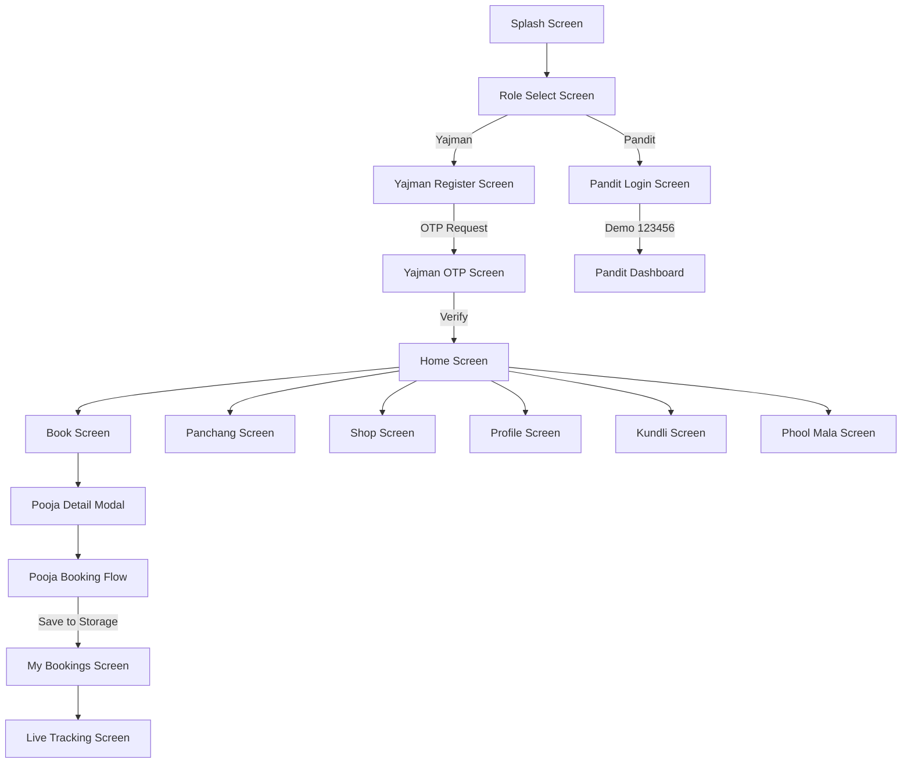
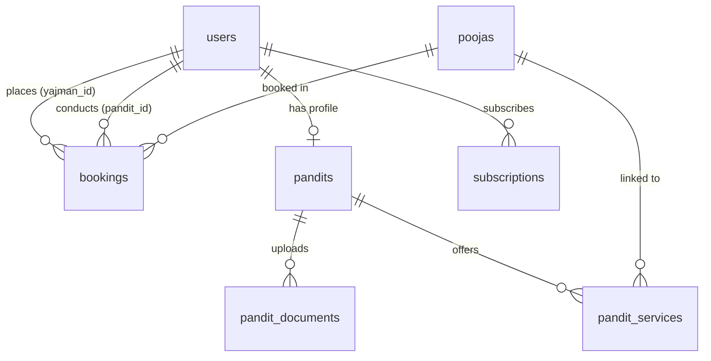

# Sarvmangal (Pandit Setu) — Application Discovery Report

---

## 1. Project Overview

### What type of application is this?
**Sarvmangal** (also branded as **Pandit Setu** in the Flutter client and **Poojapaath** in the backend) is a **Hindu devotional & Vedic ritual marketplace platform**. It connects Hindu devotees (**Yajmans**) with certified Vedic priests (**Pandits**) for:
- Home & office rituals (Offline Poojas like Griha Pravesh, Satyanarayan Katha, Vivah, Vastu Shanti).
- Virtual live e-poojas via video call (Online Poojas).
- Vedic astrological consultations (immediate & scheduled, call & video).
- Traditional handwritten horoscopes (Handmade Kundli).
- Daily fresh flower & garland deliveries/subscriptions (Phool Mala).
- Rapid delivery of pooja items & havan samagri kits (Pooja Store / Instant Delivery).
- Temple schedules, daily Panchang (Hindu calendar), and spiritual AI problem resolution.

### What platforms are present?
- **Mobile (Flutter)**: Configured for Android, iOS, Web, Windows, macOS, and Linux targets via standard Flutter project scaffolding.
- **Backend (Node.js/Express)**: A RESTful & WebSocket API server.
- **Admin Portal**: **MISSING**. No web admin dashboard or administration screens exist in the codebase.

### Identifiable Versions & Technologies:
- **Flutter / Dart SDK**: Dart SDK `^3.11.5` (Flutter 3.x), Material 3 design system.
- **Backend Technology**: Node.js (ES Modules, TypeScript `v5.8.3`, running via `tsx watch`, Express `v5.1.0`).
- **Database Technology**: PostgreSQL with the **PostGIS** geospatial extension, managed via **Drizzle ORM** `v0.44.2` and **Drizzle Kit** `v0.31.1`.
- **In-Memory Store / Cache**: Redis (`ioredis` `v6.0.0`, `@socket.io/redis-adapter` `v8.3.0`), plus in-memory Node `Map` stores.
- **Real-Time Communication**: `socket.io` `v4.8.3` (WebSocket server initialized in `server.ts`).
- **Video Calling**: Agora Token Generator (`agora-token` `v2.0.6`) configured on the backend.
- **Payments**: Razorpay Node SDK (`razorpay` `v2.9.8`) on the backend.
- **Push Notifications**: Firebase Admin SDK (`firebase-admin` `v14.4.0`) on the backend.

---

## 2. Complete Project Structure

```
pndtbcknd/
├── .env.example                          # Sample backend environment configuration
├── package.json                          # Backend dependencies and scripts
├── tsconfig.json                         # TypeScript configuration
├── drizzle.config.ts                     # Drizzle ORM migration configuration
├── convert_excel.cjs                     # Build script to dump Excel data into JSON assets
├── Pooja List.xlsx                       # Source Excel spreadsheet of poojas
├── drizzle/                              # SQL migrations generated by drizzle-kit
│   ├── 0000_init.sql                     # Base tables (users, pandits, poojas, products, bookings)
│   ├── 0001_slow_sharon_carter.sql       # Added samagri_price to poojas
│   ├── 0002_postgis_setup.sql            # PostGIS extension & spatial indexing
│   ├── 0003_razorpay_columns.sql         # Added razorpay_order_id & payment_id to bookings
│   ├── 0004_add_subscriptions_table.sql  # Added subscription_status enum
│   └── 0005_fcm_token.sql                # Added subscriptions table & users.fcm_token
├── src/                                  # Backend Source Code (Express + TypeScript)
│   ├── app.ts                            # Express application entry, CORS, and top-level routes
│   ├── server.ts                         # HTTP & Socket.IO server initialization
│   ├── auth/                             # Auth helpers
│   ├── config/                           # Database, Redis, and Environment configs
│   ├── controllers/                      # Express route controllers
│   ├── db/                               # Drizzle schema definitions, seed script, custom PostGIS types
│   ├── middleware/                       # JWT auth, role validation, rate limiting, error handler
│   ├── routes/                           # API route definitions
│   ├── services/                         # Business logic (agora, auth, bookings, payments, tracking)
│   ├── tests/                            # Automated Vitest test suites
│   ├── types/                            # TypeScript declarations
│   ├── utils/                            # Logging, response formatting, pagination
│   └── validators/                       # Zod validation schemas
└── frontend/
    └── pandit_ssetu/                     # Flutter Frontend Project
        ├── pubspec.yaml                  # Flutter package dependencies and asset declarations
        ├── assets/                       # Image assets and bundled JSON data
        │   ├── data/
        │   │   ├── pandits.json          # Dumped static Pandit dataset
        │   │   └── products.json         # 500+ items dumped from master Excel spreadsheet
        │   └── images/                   # PNG and JPEG assets for banners and icons
        └── lib/                          # Flutter Source Code
            ├── main.dart                 # App entry point and GoRouter configuration
            ├── user_data.dart            # In-memory static user profile store
            ├── user_profile_detail_screen.dart # Detailed user editable profile screen
            ├── screens/                  # 19 Full-screen Flutter pages
            ├── services/                 # ApiService (HTTP client) & LanguageService (Hindi toggle)
            └── widgets/                  # Modals, side drawer, bottom nav, custom buttons
```

### Major Folders & Dependencies

| Folder | Purpose | Important Files | What Depends On It |
| :--- | :--- | :--- | :--- |
| `src/routes/` | Defines HTTP REST endpoints | `index.ts`, `bookings.routes.ts`, `pandits.routes.ts` | Mounted by `app.ts`; invokes controllers |
| `src/controllers/` | Extracts HTTP parameters, delegates to services | `bookings.controller.ts`, `auth.controller.ts` | Invoked by routes; calls services and response utils |
| `src/services/` | Core business logic & external SDK wrappers | `bookings.service.ts`, `payments.service.ts`, `tracking.service.ts` | Invoked by controllers and WebSockets |
| `src/db/schema/` | Database tables & relations in Drizzle ORM | `users.ts`, `bookings.ts`, `pandits.ts`, `poojas.ts` | Imported by all services, database migrations, seed scripts |
| `frontend/.../screens/` | Flutter UI screens for Yajman and Pandit | `home_screen.dart`, `book_screen.dart`, `pandit_dashboard_screen.dart` | Referenced in `main.dart` routing table |
| `frontend/.../widgets/` | Modal dialogs, bottom sheets, navigation bars | `consultation_flow_modal.dart`, `pooja_detail_modal.dart` | Rendered inside screens |
| `frontend/.../services/` | Frontend HTTP client and language provider | `api_service.dart`, `language_service.dart` | Consumed by registration, OTP, profile, and booking screens |

---

## 3. Complete App Screen Map

Discovered directly from `main.dart` and screen files:

```
App Launch (/)
└── SplashScreen (/): 2-second animated marigold intro
    └── RoleSelectScreen (/role-select): Choose "Yajman" or "Pandit"
        ├── [Path A: Yajman]
        │   └── YajmanRegisterScreen (/yajman-register): Name, 10-digit phone, optional email
        │       └── YajmanOtpScreen (/yajman-otp): 6-digit OTP verification & Dev Code alert
        │           └── HomeScreen (/home): Main Yajman Hub
        │               ├── TopBar: Drawer, Sarvmangal logo, Hindi/English toggle, Notifications
        │               ├── Hero Carousel Banner: 4 festival pooja slides with "Book Pooja Now"
        │               ├── Six-Box Service Grid:
        │               │   ├── 1. Book Pooja: Opens "Pooja Format" Dialog (Offline vs Online)
        │               │   │   ├── Offline -> BookScreen (/book?mode=offline)
        │               │   │   └── Online -> BookScreen (/book?mode=online)
        │               │   ├── 2. Consultation: Opens ConsultationFlowModal (Bottom Sheet)
        │               │   ├── 3. Handmade Kundali: Navigates to KundliScreen (/kundli)
        │               │   ├── 4. Phool Mala: Navigates to PhoolMalaScreen (/phool-mala)
        │               │   ├── 5. Instant Delivery: Navigates to ShopScreen (/shop)
        │               │   └── 6. Nearest Temple: Opens "Coming Soon" Alert Dialog
        │               ├── "Life Problems?" Banner: Opens PanditChatModal (Simulated AI chat)
        │               ├── Upcoming Booking Banner: Displays latest booking or fallback card
        │               ├── Round Category Menu: Pooja Kits, Accessories, Essentials, Idols & Yantras
        │               ├── Enhanced Panchang Section: Tithi, Nakshatra, Shubh Muhurat card
        │               ├── Rarest Divine Items Carousel: Shivaling, Conch, Yantra cards
        │               ├── Trending Rituals Section: Griha Pravesh, Satyanarayan, Vastu Shanti
        │               └── Blog Section & Trust Badges
        │
        ├── BookScreen (/book?category=...&mode=offline|online):
        │   ├── Mode Switcher: Toggle between In-Person Home visit and Live Video
        │   ├── Category Pills: Ghar & Jeevan, Sanskar, Dosh Nivaran, etc.
        │   └── Pooja List: Cards with duration, price, inclusions
        │       └── PoojaDetailBottomSheet (Modal): Inclusions, chanting details, breakdown
        │           └── PoojaBookingFlowScreen (/book-flow): 4-step wizard
        │               ├── Step 1: Date & Time slot, Venue Address (or Gotra/Platform for Online)
        │               ├── Step 2: Samagri inclusion (None, Standard, Premium Kit)
        │               ├── Step 3: Pandit Selection (Auto-allocate vs Manual list)
        │               └── Step 4: Order Summary & Payment Mode -> Success Alert
        │
        ├── BookingsScreen (/bookings):
        │   ├── Tab 1: Upcoming Rituals (Allocation timer, address, "Contact Pandit")
        │   └── Tab 2: Completed Rites
        │
        ├── LivePoojaTrackingScreen (/tracking):
        │   ├── Progress Tracker: Pandit Assigned -> Samagri Dispatched -> En Route -> In Progress -> Completed
        │   ├── Map Simulation: Positioned marker representing Pandit movement
        │   └── Contact Pandit & View Instructions buttons
        │
        ├── KundliScreen (/kundli):
        │   ├── Tab 1: Kundli Overview (Custom-painted Lagna Ascendant Chart)
        │   │   └── "Order Handmade Kundli" -> HandmadeKundliOrderModal (Multi-step order)
        │   ├── Tab 2: Dosha Analysis (Manglik Dosh, Kalsarpa Dosh, Sade Sati status cards)
        │   └── Tab 3: Shubh Muhurat (Abhijit, Brahma, Rahu Kaal, Yamaganda timings)
        │
        ├── PhoolMalaScreen (/phool-mala):
        │   ├── Tab 1: Monthly Subscription Plans (Festive Offer, Daily Morning, Grand Temple)
        │   └── Tab 2: Daily Single Orders (Marigold Garland, Belpatra, Rose Petals, Tulsi)
        │
        ├── ShopScreen (/shop):
        │   ├── Search bar & Category filters
        │   └── 500+ Product grid loaded from local JSON with "Add to Cart"
        │
        ├── PanchangScreen (/panchang):
        │   ├── Month/Year calendar navigation
        │   ├── Festival & Vrat list lookup
        │   └── Detailed Tithi, Nakshatra, Yoga, Karana, Choghadiya cards
        │
        ├── NearestTempleScreen (/nearest-temple):
        │   ├── GPS Location detection simulator
        │   └── Hardcoded temple cards (Mahakaleshwar, Harsiddhi, Kal Bhairav)
        │
        ├── NotificationsScreen (/notifications):
        │   └── Filterable mock notification cards (Bookings, Muhurat, Festivals)
        │
        ├── SupportScreen (/support):
        │   ├── Searchable FAQs with expandable answers
        │   └── Direct WhatsApp & Phone call action tiles
        │
        ├── ProfileScreen (/profile) & UserProfileDetailScreen (/profile/detail):
        │   └── Devotee personal info, birth details, Gotra, Zodiac, City
        │
        └── [Path B: Pandit]
            └── PanditLoginScreen (/pandit-login): Phone login with hardcoded "123456" OTP
                └── PanditDashboardScreen (/pandit-dashboard):
                    ├── Duty Toggle: Switch Online / Offline
                    ├── Incoming Booking Request Banner: 30-second timer, Accept/Decline
                    ├── Duty Execution Flow: Heading to Venue -> Arrived -> Sankalpa -> Complete
                    ├── Live Pooja Chanting Timer
                    ├── Earnings Dashboard & Completed rites counter
                    └── Instant Dakshina Payout dialog
```

### Detailed Screen Specification

| Screen Name | File Path | Entry Trigger | Key Actions / Buttons | Data Displayed | Connected API / Dependencies | Real Status |
| :--- | :--- | :--- | :--- | :--- | :--- | :--- |
| **SplashScreen** | `splash_screen.dart` | Initial launch (`/`) | Auto-navigates after 2 seconds | Logo, Sanskrit shloka | None | 🟢 Fully Functional (Internal UI animation) |
| **RoleSelectScreen** | `role_select_screen.dart` | From Splash | Select "Yajman" or "Pandit", "Continue" | Role cards | Local state | 🟢 Fully Functional (Navigation) |
| **YajmanRegisterScreen** | `yajman_register_screen.dart` | From Role Select (`/yajman-register`) | "Send OTP / Continue" button | Name, 10-digit Phone, Email fields | `POST /auth/send-otp` via `ApiService.sendOtp` | 🟡 Partially Connected (Calls backend; backend generates mock OTP) |
| **YajmanOtpScreen** | `yajman_otp_screen.dart` | From Register (`/yajman-otp`) | 6-box input, "Verify OTP", "Resend OTP" | Countdown timer, dev OTP snackbar | `POST /auth/verify-otp` via `ApiService.verifyOtp` | 🟡 Partially Connected (Validates with backend, stores JWT & user in `SharedPreferences`) |
| **HomeScreen** | `home_screen.dart` | From OTP or Bottom Nav (`/home`) | Language toggle, Drawer open, Hero CTA, 6-box grid, Life Problems CTA, Bottom Nav | Hero slides, services, Panchang, trending poojas | `ApiService.getUserBookings` (reads local `SharedPreferences`) | 🟡 Partially Connected (Reads local storage for bookings; rest is hardcoded UI) |
| **BookScreen** | `book_screen.dart` | From Home Grid or Bottom Nav (`/book`) | Switch Online/Offline, category selection, "View Details & Book" | Hardcoded poojas (Griha Pravesh, Satyanarayan, Vivah) | None (Does NOT call `GET /poojas`) | 🔵 UI Only (Hardcoded local list) |
| **PoojaDetailBottomSheet** | `pooja_detail_modal.dart` | From BookScreen or Home ritual cards | "Proceed to Book" button | Description, inclusions, duration breakdown, prices | Passes `PoojaDetail` to router extra | 🔵 UI Only (Client modal) |
| **PoojaBookingFlowScreen** | `pooja_booking_flow_screen.dart` | From PoojaDetail modal (`/book-flow`) | Step 1-4 navigation, samagri toggle, pandit select, "Confirm & Pay" | Date/time, address, samagri options, price breakdown | Calls `ApiService.getNearbyPandits` and `ApiService.createBooking` | 🔴 Broken / Fallback (Payload fails backend validation; falls back to saving mock in `SharedPreferences`) |
| **BookingsScreen** | `bookings_screen.dart` | From Drawer or Home (`/bookings`) | Tabs (Upcoming / Completed), "Contact Pandit" | List of booked poojas, allocation countdown | `ApiService.getUserBookings` (local `SharedPreferences`) | 🔵 UI Only / Local Storage Only |
| **LivePoojaTrackingScreen** | `live_pooja_tracking_screen.dart` | Route `/tracking` | Step progression preview, "Contact Pandit" | Progress timeline, simulated map dot, pandit card | Reads latest booking from `SharedPreferences` | 🔵 UI Only (Mock simulation; not connected to WebSocket or backend tracking) |
| **KundliScreen** | `kundli_screen.dart` | From Home Grid (`/kundli`) | Tabs, "Order Handmade Kundli", Save Astro Profile | Custom Painted Lagna Chart, Dosha analysis cards, Muhurats | In-memory `UserData` | 🔵 UI Only |
| **HandmadeKundliOrderModal** | `handmade_kundli_order_modal.dart` | From KundliScreen button | Step 0 (Form) -> Step 1 (Payment option) -> Step 2 (Confirmation) | Birth form, Token ₹251 or Full ₹1501, Admin Allotment summary | Local widget state (900ms timer simulation) | 🔵 UI Only (Simulated payment & admin allotment) |
| **ConsultationFlowModal** | `consultation_flow_modal.dart` | From Home Grid "Consultation" | Select Online/Offline -> Select 15/30/60m -> Select Call/Meet -> Confirm | Duration pricing, office locations, reason form, simulated Meet link | Local widget state | 🔵 UI Only (Completely mock state machine) |
| **PanditChatModal** | `pandit_chat_modal.dart` | From Home "Life Problems?" banner | Topic quick chips, text input, send button | Simulated Acharya responses (if/else keyword check) | In-memory message list | 🔵 UI Only (Local scripted responses, NO AI API) |
| **PhoolMalaScreen** | `phool_mala_screen.dart` | From Home Grid (`/phool-mala`) | Tab toggle, "Subscribe Now", "Add to Cart" | Subscription plans (₹399, ₹499), daily flowers list | Local `showDialog` alert | 🔵 UI Only (No backend subscription call) |
| **ShopScreen** | `shop_screen.dart` | Bottom Nav or Grid (`/shop`) | Category chips, Search bar, Sort menu, "Add to Cart" | 500+ items loaded from `assets/data/products.json` | Local asset loader (`rootBundle`) | 🔵 UI Only (Does not call backend `GET /products`) |
| **PanchangScreen** | `panchang_screen.dart` | Bottom Nav (`/panchang`) | Month navigation, Jump to today, Date click | Tithi, Nakshatra, Auspicious/Inauspicious timings, Festivals | Hardcoded dataset and calendar math | 🔵 UI Only |
| **NearestTempleScreen** | `nearest_temple_screen.dart` | Route `/nearest-temple` | "Detect Location" button | Hardcoded Ujjain temple cards, timings, crowd indicator | 2-second mock Timer | 🔵 UI Only (Does not call backend `GET /temples/nearby`) |
| **NotificationsScreen** | `notifications_screen.dart` | Top Bar bell icon (`/notifications`) | Filter chips (All, Bookings, Muhurat & Festivals) | Hardcoded notification cards | None | 🔵 UI Only |
| **SupportScreen** | `support_screen.dart` | From Drawer (`/support`) | Search FAQs, Expand FAQ tile, Call Helpline, WhatsApp Chat | Helpline numbers, email, FAQ list | None | 🔵 UI Only |
| **ProfileScreen** | `profile_screen.dart` | Bottom Nav or Drawer (`/profile`) | "Edit Profile", Vedic detail cards | Devotee name, Gotra, Rashi, Dob, City | Calls `GET /auth/profile` via `ApiService.getProfile` | 🔴 Broken (Backend has no `/auth/profile`; fails and displays fallback) |
| **UserProfileDetailScreen** | `user_profile_detail_screen.dart` | From Profile (`/profile/detail`) | "Edit", Text fields, "Save Changes" | Name, Phone, Email, DOB, TOB, POB, Gotra, Zodiac | Saves only to local in-memory `UserData` | 🔵 UI Only |
| **PanditLoginScreen** | `pandit_login_screen.dart` | From Role Select (`/pandit-login`) | Phone input, "Get OTP", OTP input (123456), "Verify OTP" | Countdown timer, dev OTP snackbar | 800ms mock delay (Does NOT call backend API) | 🔵 UI Only (Demo bypass) |
| **PanditDashboardScreen** | `pandit_dashboard_screen.dart` | From Pandit Login (`/pandit-dashboard`) | Online/Offline toggle, Accept/Decline request, Arrive, Start Sankalpa, Complete, Instant Payout | Earnings, incoming request modal, pooja timer | In-memory simulated state | 🔵 UI Only (Does NOT call backend pandit endpoints) |

---

## 4. User Roles

The codebase implements three user roles in its PostgreSQL schema enum (`user_role`: `'YAJMAN'`, `'PANDIT'`, `'ADMIN'`).

```
                    ┌─────────────── User Roles ───────────────┐
                    │                                          │
            ┌───────┴───────┐                  ┌───────────────┴───────────────┐
            │    YAJMAN     │                  │            PANDIT             │
            └───────┬───────┘                  └───────────────┬───────────────┘
                    │                                          │
       Phone Registration & OTP                   Demo Phone Login (Bypasses API)
                    │                                          │
        Interactive Home Dashboard                 Simulated Duty Dashboard
                    │                                          │
    Bookings / Catalog / Panchang / Kundli     Accept Requests / Duty Timers / Earnings
                    │                                          │
   Calls Auth & Local Storage Fallbacks           Completely In-Memory UI State
```

### 1. Yajman (Devotee / Customer)
- **Login Flow**: Enters 10-digit mobile number on `yajman_register_screen.dart`. Receives 6-digit mock OTP generated by backend `auth.service.ts`. Enters OTP on `yajman_otp_screen.dart`. On success, receives JWT token and navigates to `/home`.
- **Home**: Accesses hero carousel, 6-box service grid, "Life Problems?" banner, category menus, panchang overview, and navigation bar.
- **Features & Actions**: Books poojas, configures samagri, selects pandits, orders handmade kundli, orders flowers, browses 500+ pooja items, reviews panchang, chats with simulated pandit, and views past bookings.
- **Backend Interaction**: Connected for OTP send/verify; booking creation attempts to hit backend but falls back to local storage due to schema mismatch; profile fetch fails because of route path mismatch.

### 2. Pandit (Priest / Service Provider)
- **Login Flow**: Enters mobile number on `pandit_login_screen.dart`. The screen **does not call the backend**; it triggers an internal 800ms timer with a mock code `123456`, verifies internally, and redirects to `/pandit-dashboard`.
- **Home / Dashboard**: `pandit_dashboard_screen.dart` provides an interactive duty screen.
- **Features & Actions**:
  - Toggle duty online/offline.
  - Automatically receives simulated incoming booking popups after 3 seconds with a 30-second countdown.
  - Can Accept or Decline.
  - On acceptance, walks through duty steps: "Heading to Venue" -> "Mark Arrived" -> "Start Sankalpa" (starts live timer) -> "Complete Pooja" (increments today's earnings by ₹2,625).
  - Can open "Instant Dakshina Payout" modal.
- **Backend Interaction**: **NONE from Flutter**. All Pandit UI actions are simulated locally. (Note: The backend has actual endpoints for pandit duty status, nearby queries, and booking acceptance in `pandits.routes.ts`, but Flutter does not call them).

### 3. Admin
- **Implementation Status**: **COMPLETELY MISSING**.
- **Backend Route**: The only admin endpoint in the backend is `GET /api/v1/admin/health` in `routes/index.ts`, which checks for the `ADMIN` JWT role and returns `{ status: "ok" }`.
- **Frontend**: There is no Admin screen, no Admin route in `main.dart`, and no web administration console in the repository.

---

## 5. Yajman Feature Discovery

| Feature | Exists in UI? | Backend Connected? | Database Connected? | External Service? | Actually Functional? | Evidence / File Path |
| :--- | :--- | :--- | :--- | :--- | :--- | :--- |
| **Online Puja** | Yes | No | No | No (No Agora/Meet in UI) | 🔵 UI Only | `book_screen.dart` |
| **Offline Puja** | Yes | No | No | No | 🔵 UI Only | `book_screen.dart` |
| **Puja List** | Yes | No | No | No | 🔵 UI Only (Hardcoded in UI) | `book_screen.dart` |
| **Puja Details** | Yes | No | No | No | 🔵 UI Only | `pooja_detail_modal.dart` |
| **Date Selection** | Yes | No | No | No | 🔵 UI Only | `pooja_booking_flow_screen.dart` |
| **Time Selection** | Yes | No | No | No | 🔵 UI Only | `pooja_booking_flow_screen.dart` |
| **Location / Address** | Yes | No | No | No | 🔵 UI Only (Text fields) | `pooja_booking_flow_screen.dart` |
| **Manual Pandit Selection** | Yes | No (Falls back to mock) | No | No | 🔵 UI Only (Mock list) | `api_service.dart` |
| **Automatic Pandit Selection** | Yes | No | No | No | 🔵 UI Only (180s timer UI) | `bookings_screen.dart` |
| **Nearby Pandit Search** | No in UI | Backend has endpoint | Yes (`pandits` PostGIS) | PostGIS | 🟡 Partially Connected (Backend works; UI calls without required lat/lng params) | `pandits.routes.ts`, `api_service.dart` |
| **Material Inclusion / Samagri** | Yes | No | No | No | 🔵 UI Only | `pooja_booking_flow_screen.dart` |
| **Payment (Pooja)** | Yes (UI Selector) | Backend has Razorpay | Backend has fields | Razorpay SDK missing in Flutter | 🔴 Broken in Flutter (Radio button selection only; no SDK invocation) | `pooja_booking_flow_screen.dart` |
| **Booking Confirmation** | Yes | No (Saves to `SharedPreferences`) | No | No | 🟡 Partially Functional (Local storage only) | `api_service.dart` |
| **Consultation (Online)** | Yes | No | No | No (Dummy Google Meet URL) | 🔵 UI Only | `consultation_flow_modal.dart` |
| **Consultation (Offline)** | Yes | No | No | No | 🔵 UI Only | `consultation_flow_modal.dart` |
| **Immediate vs Scheduled** | Yes | No | No | No | 🔵 UI Only | `consultation_flow_modal.dart` |
| **15 / 30 / 60 Min Duration** | Yes | No | No | No | 🔵 UI Only | `consultation_flow_modal.dart` |
| **Phone / Video Meeting** | Yes | No | No | No | 🔵 UI Only | `consultation_flow_modal.dart` |
| **Pandit Assignment by Admin** | Yes (Simulated Text) | No | No | No | 🔵 UI Only | `consultation_flow_modal.dart` |
| **Kundli Chart (Lagna)** | Yes | No | No | No | 🔵 UI Only (CustomPaint canvas) | `kundli_screen.dart` |
| **Kundli Form (DOB, Time, POB)**| Yes | No | No | No | 🔵 UI Only (Saves to `UserData` memory) | `kundli_screen.dart` |
| **Handmade Kundli Order** | Yes | No | No | No | 🔵 UI Only (Simulated step 2) | `handmade_kundli_order_modal.dart` |
| **Flowers / Mala Subscription** | Yes | Backend has route | Backend has table | Backend has Razorpay | 🔵 UI Only in Flutter (Shows alert) | `phool_mala_screen.dart` |
| **Product Catalogue (Store)** | Yes | Backend has route | Backend has table | Local asset JSON | 🟡 Partially Functional (Loads 500+ items from `products.json`) | `shop_screen.dart` |
| **Cart / Order / Delivery** | Yes (Counter) | No | No | No | 🔵 UI Only (`_cartCount++` on tap) | `shop_screen.dart` |
| **AI Chat Screen** | Yes | No | No | None | 🔵 UI Only (Scripted keyword rules) | `pandit_chat_modal.dart` |
| **AI Message Limit / Paid Lock** | No | No | No | None | Missing | `pandit_chat_modal.dart` |
| **Near Temple** | Yes | Backend has route | Redis / Places API | Google Places API (backend) | 🔵 UI Only (Hardcoded Ujjain temples) | `nearest_temple_screen.dart` |
| **Profile** | Yes | Backend has route | Backend has table | None | 🔴 Broken (Calls `/auth/profile`, which is 404) | `profile_screen.dart` |
| **Notifications** | Yes | Backend has FCM | Backend has tokens | Firebase Admin (backend) | 🔵 UI Only (Hardcoded list) | `notifications_screen.dart` |
| **Booking History** | Yes | Backend has route | Backend has table | Local storage | 🟡 Partially Connected (Reads `SharedPreferences`) | `bookings_screen.dart` |

---

## 6. Pandit Feature Discovery

| Feature | UI? | API? | Database? | External Service? | Actually Functional? | Evidence / File Path |
| :--- | :--- | :--- | :--- | :--- | :--- | :--- |
| **Phone Login** | Yes | Backend exists | Yes | Mock SMS in backend | 🔵 UI Only in Flutter (Dummy bypass) | `pandit_login_screen.dart` |
| **OTP Verification** | Yes | Backend exists | Yes | In-memory OTP | 🔵 UI Only in Flutter (Accepts `123456`) | `pandit_login_screen.dart` |
| **Registration / Logout** | No | Backend exists | Yes | None | Missing in Flutter | `auth.service.ts` |
| **Bank Details** | No | No | No (No bank columns) | None | Missing | `pandits.ts` |
| **Legal / Pandit Documents** | No UI | No endpoint | Yes (`pandit_documents` table) | None | Missing in Flutter & Backend | `pandits.ts` |
| **30-second Video Upload** | No | No | No | None | Missing | Entire repository |
| **Admin Review / Approve** | No | No | Yes (`verification_status`) | None | Missing | Entire repository |
| **Pandit Dashboard** | Yes | Backend exists (`/pandits/dashboard`) | Yes | None | 🔵 UI Only (Local timer and state simulation) | `pandit_dashboard_screen.dart` |
| **Availability (Duty Status)** | Yes | Backend exists (`PATCH /pandits/duty-status`) | Yes (`pandits.is_available`) | Redis Geo | 🔵 UI Only in Flutter (`_isOnline = !_isOnline`) | `pandit_dashboard_screen.dart` |
| **Booking Requests (Accept/Reject)**| Yes | Backend exists (`POST /pandits/accept-booking`) | Yes (`bookings.pandit_id`) | Socket.io / FCM | 🔵 UI Only in Flutter (30s timer simulation) | `pandit_dashboard_screen.dart` |
| **Upcoming / Completed Bookings** | Yes | Backend exists | Yes | None | 🔵 UI Only in Flutter (`_completedTodayCount++`) | `pandit_dashboard_screen.dart` |
| **Instant Dakshina Payout** | Yes | No | No | None | 🔵 UI Only (Dummy dialog) | `pandit_dashboard_screen.dart` |

---

## 7. Admin Discovery

| Feature | Implemented / Partial / UI Only / Missing / Unknown | Evidence / File Path |
| :--- | :--- | :--- |
| **Admin Login** | Missing | No login page or credentials UI |
| **Admin Dashboard** | Missing | No dashboard exists in frontend or backend |
| **User Management** | Missing | No admin endpoints to view/edit users |
| **Pandit Management** | Missing | No admin routes for Pandits |
| **Pandit Verification** | Missing | `verification_status` column exists in DB, but no UI/API to review |
| **Booking Management** | Missing | No admin booking dashboard |
| **Pandit Assignment** | Missing | Mentioned in UI text, but no backend admin assignment endpoint |
| **Puja Management** | Missing | No CRUD endpoints for Poojas |
| **Product Management** | Missing | Products dumped from Excel via CLI script only |
| **Flower/Mala Management** | Missing | No subscription or delivery management |
| **Kundli Management** | Missing | Claimed in modal text; zero admin routes exist |
| **Consultation Management** | Missing | No endpoint to assign Pandits or schedule Meets |
| **Banner / Ad Management** | Missing | Slides hardcoded in `home_screen.dart` and `phool_mala_screen.dart` |
| **Payment Management** | Missing | No admin refund or ledger screen |
| **Reports & Analytics** | Missing | None |
| **Admin Health Check** | Implemented (API only) | `GET /api/v1/admin/health` in `routes/index.ts` |

---

## 8. Navigation Flow



### Broken / Incomplete Flows Discovered in Code:
1. **Broken Profile Route**: Navigating to `/profile` invokes `ApiService.getProfile()`, which calls `GET http://localhost:5000/api/v1/auth/profile`. The backend returns a `404 Not Found` because the backend route is mounted at `/api/v1/users/me`.
2. **Broken Backend Booking Creation**: When `PoojaBookingFlowScreen` submits to `POST /api/v1/bookings`, it sends an unparsed string date, time slot, slug `poojaId`, and missing `mode`. The backend Zod validator rejects the request with HTTP 400. The app catches the exception and falls back to saving a dummy record in `SharedPreferences`.
3. **Broken Nearby Pandits Query**: In `ApiService.getNearbyPandits()`, `GET /pandits/nearby` is called with no query parameters. The backend schema rejects missing `lat` and `lng`, forcing the frontend to catch the error and display 3 hardcoded static Pandits.
4. **Dead-End Cart**: Tapping "Add to Cart" in `ShopScreen` or `PhoolMalaScreen` increments an integer counter `_cartCount`. There is no cart screen, no checkout screen, and no order placement.
5. **Simulated Nearest Temple**: In `HomeScreen`, tapping "Nearest Temple" displays an alert titled "COMING SOON" rather than routing to `NearestTempleScreen`.
6. **Yajman Login Placeholder**: The route `/yajman-login` in `main.dart` renders a blank placeholder: `Scaffold(body: Center(child: Text('Yajman Login — Coming Soon')))`.

---

## 9. API Discovery

### Frontend to Backend Comparison

| Flutter API Method | HTTP Method | Endpoint | Request Data | Backend Route Exists? | Backend Match Status |
| :--- | :--- | :--- | :--- | :--- | :--- |
| `ApiService.sendOtp` | `POST` | `/api/v1/auth/send-otp` | `{ "phone": string }` | Yes (`auth.routes.ts`) | 🟢 Matched (Returns mock OTP in dev) |
| `ApiService.verifyOtp` | `POST` | `/api/v1/auth/verify-otp` | `{ "phone": string, "otp": string, "name": string }` | Yes (`auth.routes.ts`) | 🟢 Matched (Returns JWT & user record) |
| `ApiService.getProfile` | `GET` | `/api/v1/auth/profile` | None (Bearer token) | ❌ No (`/auth/profile` does not exist; backend has `/users/me`) | 🔴 Broken (404 Not Found) |
| `ApiService.getNearbyPandits` | `GET` | `/api/v1/pandits/nearby` | None (No query params sent) | Yes (`pandits.routes.ts`) | 🔴 Broken (Backend requires `lat`, `lng`, `radiusKm`; throws 400) |
| `ApiService.createBooking` | `POST` | `/api/v1/bookings` | Non-standard booking payload | Yes (`bookings.routes.ts`) | 🔴 Broken (Payload schema mismatch; catches error and saves to local storage) |
| `ApiService.getUserBookings` | Local | Reads `SharedPreferences` | None | Yes (`GET /bookings` exists in backend) | 🟡 Not Used (Does not call backend `GET /bookings`) |

---

## 10. Backend Discovery

- **Entry Points**: `app.ts` (Express app) and `server.ts` (HTTP + Socket.IO server).
- **Routes & Controllers**:
  - `auth`: Send OTP, verify OTP & register.
  - `users`: Get profile (`/me`), update profile (`/me`), update FCM token (`/fcm-token`).
  - `poojas`: List active poojas with offset pagination.
  - `products`: List active products with offset pagination.
  - `bookings`: Create booking (with idempotency check), cursor-paginated list, get booking by ID, cancel booking, update status, generate Agora RTC video token.
  - `pandits`: Get dashboard stats, query nearby pandits via PostGIS, update duty availability, accept booking.
  - `temples`: Nearby temples search via Google Places API cached in Redis by Geohash.
  - `payments`: Razorpay order creation, payment signature HMAC verification, webhook handler.
  - `subscriptions`: Razorpay subscription creation.
  - `tracking`: High-frequency location updates with 1 req/sec Redis rate limiting, WebSocket broadcast, and 30-second debounced Postgres persistence.
- **Middleware**:
  - `verify-token.ts`: Decodes Bearer JWT and sets `req.user`.
  - `require-role.ts`: Restricts routes by role (`YAJMAN`, `PANDIT`, `ADMIN`).
  - `rate-limit.ts`: In-memory express rate limiters for OTP, strict endpoints, and general APIs.
  - `error-handler.ts`: Global error handling returning uniform JSON error responses.

---

## 11. Database Discovery

- **Database Engine**: PostgreSQL with PostGIS extension.
- **ORM**: Drizzle ORM.
- **Migrations Present**: 6 migration files in `drizzle/` (0000 to 0005).
- **Seed Data**: `src/db/seed.ts` contains 2,264 lines seeding dozens of Poojas and hundreds of Products.

### Database Tables & Fields

1. **`users`**: `id` (UUID PK), `phone` (unique), `full_name`, `dob`, `tob`, `pob`, `gotra`, `zodiac`, `city`, `email`, `profile_picture_url`, `fcm_token`, `role` (enum: YAJMAN, PANDIT, ADMIN), `created_at`, `updated_at`.
2. **`pandits`**: `id` (UUID PK), `user_id` (FK -> users.id), `experience_years`, `vedic_specialization`, `languages` (JSONB), `bio`, `is_verified`, `verification_status` (PENDING, APPROVED, REJECTED), `service_radius_km`, `latitude`, `longitude`, `location` (geometry Point 4326 with GIST index), `is_available`, `rating`, `created_at`, `updated_at`.
3. **`pandit_documents`**: `id` (UUID PK), `pandit_id` (FK -> pandits.id), `doc_type` (AADHAAR, PAN, DEGREE_CERTIFICATE, OTHER), `doc_url`, `status` (PENDING, VERIFIED, REJECTED), `created_at`, `updated_at`.
4. **`pandit_services`**: Composite PK (`pandit_id`, `pooja_id`), `custom_price`, `created_at`, `updated_at`.
5. **`pandit_profiles`**: `id` (UUID PK), `user_id` (FK -> users.id), `verification_stage` (STAGE_1_COMPLETE, DOCS_SUBMITTED, VERIFIED, REJECTED), `is_online`, `bio`, `rating`, `location`, `created_at`, `updated_at`.
6. **`poojas`**: `id` (UUID PK), `title`, `slug` (unique), `description`, `base_price`, `samagri_price`, `duration_minutes`, `image_url`, `is_active`, `created_at`, `updated_at`.
7. **`bookings`**: `id` (UUID PK), `yajman_id` (FK -> users.id), `pandit_id` (FK -> users.id, nullable), `pooja_id` (FK -> poojas.id), `mode` (IN_PERSON, ONLINE), `booking_time`, `venue_location` (Point 4326), `venue_address`, `samagri_included`, `custom_notes`, `total_amount`, `status` (PENDING, CONFIRMED, IN_PROGRESS, COMPLETED, CANCELLED), `idempotency_key_hash`, `razorpay_order_id`, `payment_id`, `payment_status` (PENDING, PAID, FAILED), `created_at`, `updated_at`.
8. **`products`**: `id` (UUID PK), `name`, `description`, `price`, `category`, `badge`, `samagri` (text[]), `image_url`, `isActive`, `created_at`.
9. **`subscriptions`**: `id` (UUID PK), `user_id` (FK -> users.id), `razorpay_subscription_id` (unique), `plan_id`, `status` (CREATED, AUTHENTICATED, ACTIVE, PENDING, HALTED, CANCELLED, COMPLETED, EXPIRED), `current_period_end`, `created_at`, `updated_at`.

### Entity Relationship Map



---

## 12. External Services Discovery

| External Service | Backend Status | Flutter Frontend Status | Real Integration Classification | Notes |
| :--- | :--- | :--- | :--- | :--- |
| **Firebase Cloud Messaging** | Code in `notification.service.ts` | Missing | 🟡 Partially Integrated | Backend sends push notifications via `firebase-admin`, but Flutter lacks `firebase_messaging` to receive them. |
| **SMS / OTP Service** | Mock code in `sms.service.ts` | Receives dev mock OTP | 🟡 Partially Integrated (Mock) | No real SMS provider (Twilio, MSG91, Fast2SMS) configured. Logs to terminal and sends in response body. |
| **Razorpay Payments** | Code in `payments.service.ts` | Missing | 🟡 Partially Integrated | Backend order creation, HMAC signature verification, and webhooks are implemented; Flutter lacks `razorpay_flutter` SDK. |
| **Agora Video Calling** | Code in `agora.service.ts` | Missing | 🟡 Partially Integrated | Backend generates Agora RTC tokens; Flutter app has no Agora RTC video view or SDK. |
| **Google Meet** | None | Hardcoded link in UI modal | 🔵 UI Only (Dummy string) | Uses a static string `https://meet.google.com/smg-vedic-session-7842`. No Google Calendar/Workspace API. |
| **Google Places API** | Code in `temples.service.ts` | Missing | 🟡 Partially Integrated | Backend fetches Hindu temples using Google Places API; Flutter screen uses hardcoded local Ujjain list. |
| **AI Provider (OpenAI/Gemini)**| None | None | ❌ Not Found | No AI package, no backend route, no LLM SDK. Chat in Flutter is an in-memory string matching switch statement. |
| **Redis** | Code in `redis.ts` | N/A (Backend only) | 🟢 Actually Integrated | Used in backend for idempotency caching, Geohash temple caching, rate-limiting, and Socket.io adapter. |
| **Socket.IO (WebSocket)** | Code in `realtime.service.ts` | Missing | 🟡 Partially Integrated | Backend has room broadcasting for tracking & status updates; Flutter app does not include `socket_io_client`. |
| **Cloud File Storage (S3/GCS)**| None | None | ❌ Not Found | No file upload/storage mechanism (AWS S3, Cloudinary, Firebase Storage) found in codebase. |

---

## 13. UI vs Real Functionality Summary

- **🟢 FULLY FUNCTIONAL**:
  - Splash animation & role selection navigation.
  - Language switching toggle (Hindi / English state update in UI).
- **🟡 PARTIALLY FUNCTIONAL**:
  - **Registration & OTP verification**: Flutter calls backend; backend validates in-memory OTP and returns user & JWT; Flutter stores credentials in `SharedPreferences`.
  - **Pooja Store Catalog**: Loads and searches 500+ items, but reads from local `products.json` instead of backend API.
  - **Backend API Server**: The backend itself is largely complete and tested for Bookings, Payments, Tracking, Temples, and Subscriptions, but the Flutter frontend is disconnected from them.
- **🔵 UI ONLY**:
  - Pooja listing, categories, and detail cards.
  - Live Pooja Tracking screen (simulated dot and timeline).
  - Consultation booking modal (both Online and Offline flows).
  - Kundli chart & Handmade Kundli order flow.
  - Phool Mala daily orders & subscriptions.
  - Pandit Chat modal (simulated keyword-based replies).
  - Nearest Temple finder (hardcoded list).
  - Pandit Login & Pandit Duty Execution dashboard.
  - Notifications & Support FAQ screens.
- **🔴 BROKEN**:
  - **User Profile Fetching**: `ApiService.getProfile` requests `/auth/profile`, which does not exist on the backend (returns 404).
  - **Pooja Booking Submission**: Payload structure from `pooja_booking_flow_screen.dart` fails backend Zod validation, silently dropping back to a local storage mock.
  - **Nearby Pandits API Call**: Frontend does not send required latitude/longitude query params, causing backend 400 rejection and triggering mock fallback.
- **⚪ UNKNOWN**:
  - Live behavior of Agora and Razorpay webhooks in production environment (requires live credentials and active deployment to verify).

---

## 14. Feature Matrix

| Feature | UI | Backend | Database | External Service | Status | Evidence |
| :--- | :---: | :---: | :---: | :---: | :---: | :--- |
| **Devotee Registration & OTP** | Yes | Yes | Yes | Mock SMS | 🟡 PARTIALLY FUNCTIONAL | `auth.service.ts`, `yajman_otp_screen.dart` |
| **User Profile Management** | Yes | Yes | Yes | None | 🔴 BROKEN | `users.controller.ts`, `profile_screen.dart` (404 route mismatch) |
| **Pooja Catalog & Details** | Yes | Yes | Yes | None | 🔵 UI ONLY | `book_screen.dart` (Hardcoded list; backend not called) |
| **Pooja Booking Flow** | Yes | Yes | Yes | None | 🔴 BROKEN | `pooja_booking_flow_screen.dart` (Schema mismatch -> local fallback) |
| **Razorpay Payments** | Yes | Yes | Yes | Razorpay | 🔴 BROKEN | Backend has `payments.service.ts`; Flutter lacks Razorpay SDK |
| **Live Pooja GPS Tracking** | Yes | Yes | Yes | PostGIS / Redis | 🔵 UI Only in Flutter | Backend has `tracking.service.ts`; Flutter uses mock timer |
| **Online Video Pooja (Agora)**| Yes | Yes | No | Agora RTC | 🔵 UI Only in Flutter | Backend has `agora.service.ts`; Flutter lacks Agora SDK |
| **Astrology Consultation** | Yes | No | No | Dummy URL | 🔵 UI Only | `consultation_flow_modal.dart` |
| **Vedic Kundli Generator** | Yes | No | No | None | 🔵 UI Only | `kundli_screen.dart` (Custom canvas chart) |
| **Handmade Kundli Ordering** | Yes | No | No | None | 🔵 UI Only | `handmade_kundli_order_modal.dart` |
| **Phool Mala Subscriptions** | Yes | Yes | Yes | None | 🔵 UI Only in Flutter | Backend has `subscriptions.routes.ts`; Flutter shows local alert |
| **Pooja Store & Samagri (500+)**| Yes | Yes | Yes | Local JSON | 🟡 PARTIALLY FUNCTIONAL | `shop_screen.dart` (Loads local JSON file) |
| **AI Spiritual Chatbot** | Yes | No | No | None | 🔵 UI Only | `pandit_chat_modal.dart` (Local script) |
| **Nearest Temple Finder** | Yes | Yes | No | Google Places | 🔵 UI Only in Flutter | Backend has `temples.service.ts`; Flutter has static Ujjain cards |
| **Vedic Panchang Calendar** | Yes | No | No | None | 🔵 UI Only | `panchang_screen.dart` (Internal calendar math) |
| **Pandit Duty Dashboard** | Yes | Yes | Yes | None | 🔵 UI Only in Flutter | Backend has `pandits.service.ts`; Flutter is simulated |
| **Pandit Document Verification**| No | No | Yes | None | ❌ MISSING | Database table `pandit_documents` exists, but no UI or API routes exist |
| **Admin Portal & Management** | No | 1 route | No | None | ❌ MISSING | Backend has only `GET /admin/health`; no dashboard or CRUD exists |

---

## 15. Current State of the Application

### 1. What is already built?
- A visually rich, culturally styled Flutter frontend (19 screens and 7 major modals) covering the full user interface for Yajmans and Pandits.
- An Express.js + TypeScript backend with Drizzle ORM, PostgreSQL tables, Redis integration, PostGIS spatial queries, and unit test suites.
- Complete seed data for Poojas and Products derived from master Excel spreadsheets.

### 2. What is only UI?
- **Pooja Booking details & listings**: Hardcoded list on the client.
- **Astrology Consultation booking**: Entire modal flow is simulated.
- **Handmade Kundli order**: Form and confirmation are in-memory mock states.
- **AI Chat**: Keyword-based script without an LLM.
- **Phool Mala**: Subscriptions and cart additions are dummy dialogs/counters.
- **Live Pooja Tracking**: Static canvas map with simulated timer.
- **Nearest Temple finder**: Static list of Ujjain temples.
- **Pandit Dashboard**: All actions (duty toggle, accept, countdown, earnings) run purely on client state.

### 3. What is partially connected?
- **Authentication**: Yajman registration & OTP verification successfully communicates with the backend, receives a JWT, and stores it in Flutter's `SharedPreferences`.
- **Product Store**: Displays 500+ items, but reads from a bundled JSON file rather than the backend API.
- **Pooja Booking Flow**: Attempts to hit the backend API, but fails due to schema mismatch and falls back to local storage.

### 4. What is completely missing?
- **Admin Portal**: Zero administrative interface exists.
- **Pandit Document / Video Verification**: No upload interface or approval workflow exists.
- **Shopping Cart & Checkout**: No cart page, address selection, order placement, or checkout for physical products.
- **Real SMS Gateway**: Only mock OTP logging exists in the backend.
- **Cloud File Storage**: No S3, GCS, or CDN integration for user avatars, documents, or product images.

### 5. What appears broken?
- **Profile Fetching**: The Flutter app calls `GET /api/v1/auth/profile`, which does not exist in the backend (backend route is `/api/v1/users/me`), resulting in an HTTP 404.
- **Nearby Pandits Call**: The Flutter app calls `GET /api/v1/pandits/nearby` without required `lat`/`lng` parameters, resulting in an HTTP 400.
- **Create Booking Payload**: The booking request body from Flutter does not adhere to the backend Zod validation schema, resulting in an HTTP 400.
- **Localhost Binding**: `ApiService.baseUrl` is hardcoded to `http://localhost:5000/api/v1`, which fails on real Android/iOS devices.

### 6. What backend functionality already exists?
- OTP generation and JWT authentication.
- Full Drizzle schema for users, pandits, poojas, products, bookings, and subscriptions.
- PostGIS-powered spatial search for nearby Pandits.
- Razorpay order creation, payment signature verification, and webhook handling.
- Agora video token generation.
- Socket.IO server with Redis adapter for real-time tracking broadcasts.
- Google Places API proxy for nearby temples with Geohash caching.

### 7. What database functionality already exists?
- 6 SQL migrations establishing tables, PostGIS indexes, enums, and foreign keys.
- Comprehensive seeding script populating Poojas and Products.

### 8. What external services are already integrated?
- **Backend level only**: Redis, PostgreSQL/PostGIS, Razorpay SDK, Agora token builder, Firebase Admin SDK, Google Places API.

### 9. What external services are still required?
- **Frontend level**: Razorpay Flutter SDK, Agora Flutter SDK, Firebase Messaging (FCM) Flutter SDK, Google Maps Flutter SDK, Socket.IO Client Flutter package.
- **Backend level**: Production SMS gateway (MSG91, Twilio), Cloud object storage (AWS S3 / Cloudflare R2 / GCS) for document & image uploads, real LLM API (Gemini / OpenAI) for spiritual AI chat.

### 10. Is the current application actually connected end-to-end?
**NO.** The application is **not connected end-to-end**. The frontend is primarily a stand-alone prototype running on simulated states and local `SharedPreferences`, while the backend is an independently developed API server. Aside from the initial OTP authentication flow, the two layers are decoupled and have contract mismatches preventing live end-to-end operation.

---

## Current Project Status

- **Frontend**: 🟡 Rich UI Prototype (largely disconnected from live API)
- **Backend**: 🟢 Functional API Server (has endpoints, schemas, and tests)
- **Database**: 🟢 Migrations & Seeding Implemented (PostgreSQL + PostGIS)
- **Authentication**: 🟡 Partially Functional (Phone + OTP works with mock SMS)
- **Yajman**: 🟡 UI Complete, Backend Disconnected (falls back to local storage)
- **Pandit**: 🔵 UI Prototype Only (simulated in-memory duty flow)
- **Admin**: 🔴 Completely Missing (no portal, no management APIs)
- **Payments**: 🟡 Backend Ready, Missing in Flutter (no mobile payment gateway)
- **Notifications**: 🟡 Backend FCM Ready, Missing in Flutter (no push client)
- **AI**: 🔵 Hardcoded Mock (no real AI provider)
- **Video/Meeting**: 🟡 Backend Agora Token Ready, Missing in Flutter
- **Delivery**: 🔵 UI Only (no delivery partner API or tracking pipeline)
- **Production Readiness**: 🔴 Not Production Ready (Development Prototype)

---

## Top 10 Things We Need to Investigate Next

1. **API Contract Reconciliation**: Reconcile the request/response mismatch between `ApiService.dart` and backend Zod validators (`bookings.validator.ts`, `pandits.validator.ts`, `users.routes.ts`) so real bookings, profile fetches, and pandit queries work without falling back to mock data.
2. **Admin Portal Strategy**: Determine the architectural approach for the missing Admin Portal (whether to build a web dashboard using Next.js/Vite or integrate admin screens inside the app) to enable Pandit verification, manual assignments, and booking administration.
3. **Flutter Network Architecture & Base URL Config**: Replace the hardcoded `localhost:5000` with an environment-driven configuration (e.g. `--dart-define` or `.env`) compatible with real mobile devices and emulators.
4. **Mobile Payment Integration**: Investigate integrating the official `razorpay_flutter` package into the Flutter frontend to trigger real checkout sheets using the backend's `createRazorpayOrder` API.
5. **Real-Time WebSocket & Tracking Integration**: Add a Socket.IO client to the Flutter app to replace the simulated tracking timer on `live_pooja_tracking_screen.dart` with the backend's live location stream.
6. **Pandit Verification & Document Upload Flow**: Design the missing frontend and backend pipeline for uploading government IDs (Aadhaar, PAN), certificates, and introductory videos to populate the `pandit_documents` database table.
7. **Cloud File Storage Service**: Decide on and configure a cloud storage provider (e.g. AWS S3, Cloudflare R2, or Firebase Storage) for handling priest verification documents, profile photos, and custom media.
8. **Real SMS Gateway Integration**: Replace the mock logger in `sms.service.ts` with a production SMS vendor (such as MSG91 or Fast2SMS) for delivering real OTPs to user mobile phones.
9. **Mobile Video Calling SDK (Agora)**: Investigate integrating `agora_rtc_engine` into Flutter to consume the backend's `generateVideoTokenHandler` for live virtual e-poojas.
10. **Spiritual AI Chat Integration**: Determine whether to connect `pandit_chat_modal.dart` to an external LLM API (such as Google Gemini or OpenAI) to replace the static keyword script with authentic Vedic astrological responses.
