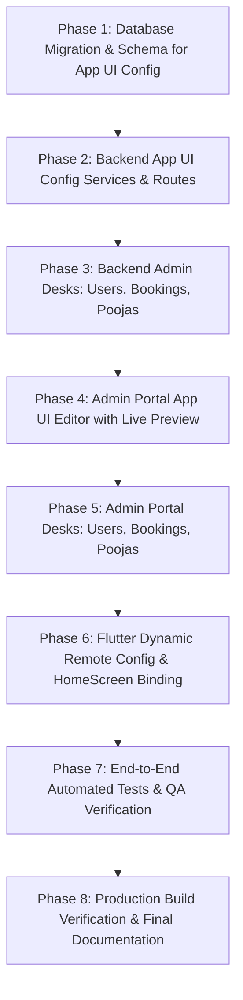

# SARV MANGAL (सर्व मंगल) — Project Completion Audit & Master Execution Plan

**Audit Date:** 2026-10-26  
**Repository:** `https://github.com/pixflowagency-ship-it/Pandit-Setu`  
**Lead Roles:** Principal Software Architect, Senior Flutter Engineer, Backend Engineer, Database Architect, Admin Portal Developer, Security & QA Engineer  
**Baseline Status:**  
- **Backend Test Suite:** 26 test files, 311/311 tests passing (100%)  
- **Flutter Test Suite:** 120/120 tests passing (100%), `flutter analyze` 0 issues  
- **Admin Portal:** Production Vite build passing in 726ms  

---

## 1. Executive Summary & Repository Discovery

The SARV MANGAL platform is a production-grade spiritual technology ecosystem connecting Yajmans (devotees), verified Vedic Pandits/Acharyas, and Temple/Astrology services across India.

### Layer Architecture & Codebase Map
```
pndtbcknd/
├── src/                                  # Node.js/TypeScript/Express REST & WebSocket API
│   ├── config/                           # Environment, Redis, and logger configs
│   ├── controllers/                      # REST endpoint controllers (Auth, Bookings, Pandits, Consultations, Kundli, Admin)
│   ├── db/                               # Drizzle ORM client, schemas, seeders, and migration scripts
│   ├── middleware/                       # verifyToken, requireRole, rate-limit, async-handler, upload
│   ├── routes/                           # Express route definitions mounted under /api/v1
│   ├── services/                         # Core domain logic (Auth, Bookings, Realtime, Tracking, SMS, Telemetry, Admin)
│   ├── tests/                            # 26 Vitest test suites covering 311 automated tests
│   └── validators/                       # Zod validation schemas
├── drizzle/                              # 17 PostgreSQL migrations (0000_init to 0016_create_approved_mantras)
├── frontend/pandit_ssetu/                # Flutter Cross-Platform Client (iOS/Android/Web)
│   ├── lib/
│   │   ├── config/                       # App routing and global configuration
│   │   ├── constants/                    # Colors, typography, and API constants
│   │   ├── screens/                      # 24 production screens (Home, Book, Kundli, Shop, Pandit Dashboard, etc.)
│   │   ├── services/                     # ApiService, LanguageService, Location, Telemetry
│   │   ├── theme/                        # Centralized design system tokens (AppColors, AppTheme, AppTypography, AppSpacing)
│   │   └── widgets/                      # Common design widgets (SarvButton, SarvCard, SarvTextField, modal dialogs)
│   └── test/                             # 120 widget, contract, and logic tests
├── admin-portal/                         # Dedicated Vite SPA for Admin Ops
│   ├── src/
│   │   ├── api.ts                        # Typed admin client calling /api/v1/admin
│   │   ├── auth.ts                       # Admin session management & storage
│   │   ├── views/                        # Login, Dashboard, and Desk tabs
│   │   │   └── tabs/                     # Overview, Pandits, Consultations, Kundli, Subscriptions
│   │   └── style.css                     # Premium modern dashboard design system
└── docs/                                 # Complete engineering specs, security audits, deployment guides
```

---

## 2. Feature Inventory & Current Status

| Feature / Domain | Flutter Screen | Backend API | Database Tables | Admin Portal Desk | Status |
| :--- | :--- | :--- | :--- | :--- | :--- |
| **Yajman Auth (OTP)** | `yajman_login_screen.dart`, `yajman_otp_screen.dart` | `POST /api/v1/auth/send-otp`, `POST /api/v1/auth/verify-otp` | `users` | N/A | **Complete & Verified** |
| **Pandit Auth & Profile** | `pandit_login_screen.dart`, `pandit_dashboard_screen.dart` | `POST /api/v1/auth/send-otp`, `GET /api/v1/pandits/me` | `users`, `pandits` | `pandits.ts` | **Complete & Verified** |
| **Pandit Onboarding & Verification** | `pandit_onboarding_screen.dart` | `POST /api/v1/pandits/documents`, `POST /api/v1/pandits/mantra-recordings` | `pandits`, `pandit_documents`, `pandit_mantra_recordings` | `pandits.ts` | **Complete & Verified** |
| **Approved Mantras Management** | Embedded in Pandit Onboarding | `GET/POST/PATCH/DELETE /api/v1/admin/mantras` | `approved_mantras` | `pandits.ts` (Mantra Catalog) | **Complete & Verified** |
| **Pooja Catalogue & Details** | `home_screen.dart`, `book_screen.dart`, `pooja_detail_modal.dart` | `GET /api/v1/poojas`, `GET /api/v1/poojas/:id` | `poojas`, `samagri` | Needs full CRUD | **Functional (Needs Admin Desk)** |
| **Pooja Booking Flow** | `pooja_booking_flow_screen.dart`, `checkout_screen.dart` | `POST /api/v1/bookings`, `POST /api/v1/payments/create-order` | `bookings`, `booking_declines` | Needs Bookings Desk | **Functional (Needs Admin Desk)** |
| **Consultation Bookings** | `consultation_flow_modal.dart` | `POST /api/v1/consultations`, `GET /api/v1/consultations/my` | `consultations` | `consultations.ts` | **Complete & Verified** |
| **Handmade Kundli Orders** | `handmade_kundli_order_modal.dart` | `POST /api/v1/kundli-orders`, `GET /api/v1/kundli-orders/my` | `kundli_orders` | `kundli.ts` | **Complete & Verified** |
| **Pooja Samagri Store** | `shop_screen.dart`, `cart_screen.dart` | `GET /api/v1/products`, `POST /api/v1/product-orders` | `products`, `product_orders` | Needs Products Desk | **Functional (Needs Admin Desk)** |
| **Live Pandit Tracking** | `live_pooja_tracking_screen.dart` | `POST /api/v1/pandits/me/telemetry`, `GET /api/v1/tracking/:bookingId` | `pandits` (location point) | N/A | **Complete & Verified** |
| **Nearest Temples** | `nearest_temple_screen.dart` | `GET /api/v1/temples/nearby` | In-memory / Google Places cache | N/A | **Complete & Verified** |
| **User Profile & Addresses** | `profile_screen.dart`, `user_profile_detail_screen.dart` | `GET/PUT /api/v1/users/profile` | `users` (address, city, state, pincode) | Needs Users Desk | **Complete (Needs Admin Desk)** |
| **Admin Authentication & RBAC** | Admin Web Portal (`login.ts`) | `POST /api/v1/admin/auth/login`, `POST /api/v1/admin/auth/logout`, `GET /api/v1/admin/auth/me` | `users` (role=ADMIN) | Full Session Guard | **Complete & Verified** |
| **App UI Editor / CMS** | New Admin Section | Missing Endpoints | Missing Table | Missing Desk | **TO BE IMPLEMENTED (Phase 6)** |

---

## 3. Gap Analysis

### 3.1 Gaps in Admin Portal
1. **App UI Editor / CMS (Critical Requirement):**
   - No table currently exists for App UI remote configuration (`app_ui_configs`).
   - No backend endpoints for fetching published configuration, drafts, publishing, versioning, or rollback.
   - Admin Portal currently lacks the visual "App UI Editor" desk with live mobile preview.
   - Flutter client currently renders static hardcoded sections instead of dynamic remote config with offline fallback.
2. **Users Management Desk:**
   - Admin Portal lacks a dedicated Users tab to view registered Yajmans/Pandits, view activity, and manage account state.
3. **Bookings Management Desk:**
   - Admin Portal lacks a central Bookings tab to inspect all Pooja bookings, filter by lifecycle status (`PENDING`, `CONFIRMED`, `IN_PROGRESS`, `COMPLETED`, `CANCELLED`), and assign/reassign Pandits.
4. **Services & Pooja Catalogue Desk:**
   - Admin Portal lacks a Services/Catalogue tab to view, edit, or adjust pricing/duration of Poojas.

### 3.2 Gaps in Backend API
1. **App UI Config Endpoints:**
   - `GET /api/v1/app-config`: Public endpoint for active published UI layout (cached in Redis / memory).
   - `GET /api/v1/admin/app-config/draft`: Admin endpoint to get current draft layout.
   - `PUT /api/v1/admin/app-config/draft`: Admin endpoint to save draft changes.
   - `POST /api/v1/admin/app-config/publish`: Admin endpoint to validate schema, commit version, and atomically publish.
   - `GET /api/v1/admin/app-config/versions`: Admin endpoint to retrieve version history and rollback targets.
   - `POST /api/v1/admin/app-config/rollback/:versionId`: Admin endpoint to roll back to a prior published version.
2. **Admin Users & Bookings Endpoints:**
   - `GET /api/v1/admin/users`: List users with pagination and search.
   - `GET /api/v1/admin/users/:id`: User detail with bookings and order history.
   - `GET /api/v1/admin/bookings`: List bookings with status filters and details.
   - `PATCH /api/v1/admin/bookings/:id/status`: Admin status override with audit logging.
   - `GET /api/v1/admin/poojas`: List poojas with edit capabilities.
   - `PATCH /api/v1/admin/poojas/:id`: Edit pooja price, description, active status.

### 3.3 Gaps in Flutter Mobile App
1. **Dynamic Remote Configuration:**
   - `AppConfigService` needs to be implemented to fetch `/api/v1/app-config`, cache the last valid config in `SharedPreferences`, and fall back to robust built-in defaults when offline or invalid.
   - `HomeScreen` needs to render sections in the dynamic order specified by remote config, respect section visibility toggles, and use remotely configured banners and titles.

---

## 4. Master Phased Execution Plan



### Detailed Phase Milestones:
* **Phase 1: Database Migration `0017_create_app_ui_configs`**
  - Create table `app_ui_configs` with `version`, `status` (`DRAFT`, `PUBLISHED`, `ARCHIVED`), `config` (JSONB), `published_by`, `published_at`, `change_summary`, timestamps.
  - Insert initial baseline configuration (Version 1, `PUBLISHED`).
* **Phase 2: Backend App UI Config Endpoints & Zod Validation**
  - Implement Zod schema `appConfigSchema` validating sections, heroSlides, serviceGrid, lifeProblemsBanner, theme tokens.
  - Implement `app-config.service.ts` with atomic publishing, versioning, Redis caching, and rollback logic.
  - Implement controller and routes (`/api/v1/app-config` and `/api/v1/admin/app-config/*`).
* **Phase 3: Backend Admin Management Endpoints**
  - Add Admin endpoints for Users (`/api/v1/admin/users`), Bookings (`/api/v1/admin/bookings`), and Poojas (`/api/v1/admin/poojas`).
* **Phase 4: Admin Portal "App UI Editor" with Live Interactive Preview**
  - Build full-featured visual editor in `admin-portal/src/views/tabs/ui_editor.ts`:
    - Section toggle & reordering (up/down).
    - Hero slides banner editor (titles, images, targets).
    - 6-box service grid editor.
    - Life Problems banner editor.
    - Theme color tokens editor.
    - Interactive mobile smartphone preview pane that updates in real time.
    - Save draft, validate, publish new version, version history list, and rollback button.
* **Phase 5: Admin Portal Desks: Users, Bookings, Poojas**
  - Build `users.ts`, `bookings.ts`, and `poojas.ts` tabs in Admin Portal.
* **Phase 6: Flutter Mobile Dynamic Remote Configuration**
  - Create `AppConfigService` in Flutter with network fetch, caching, and fallback defaults.
  - Update `HomeScreen` to render sections dynamically based on active config.
* **Phase 7: Comprehensive Automated Testing**
  - Backend Vitest test suite for UI config publishing, validation, rollback, and admin desks.
  - Flutter tests for remote config parsing, rendering, offline fallback, and invalid schema handling.
  - Admin Portal TypeScript typecheck and build validation.
* **Phase 8: Final Inspection & Completion Verification (Completed)**
  - Backend Vitest: 28 test files, 329/329 tests passing (100%).
  - Flutter Tests: 20 test files, 126/126 tests passing (100%), `flutter analyze` 0 issues.
  - Admin Portal: Production build passing with 0 errors in 1.64s (`dist/index.html`, `dist/assets/index.js`, `dist/assets/index.css`).
  - Zero exposed credentials, local `.env` preserved and untracked.
  - Authentic database persistence across all modules.

---

## 5. Verification & Completion Matrix

| Tier / Component | Verification Command | Result | Status |
| :--- | :--- | :--- | :--- |
| **Backend Static Analysis** | `npm run typecheck` | 0 errors | **Verified & Clean** |
| **Backend Test Suite** | `npm test` | 28 suites, 329 passed (100%) | **Verified & Passing** |
| **App UI Config Tests** | `npx vitest run src/tests/app_config.test.ts` | 9 passed (100%) | **Verified & Passing** |
| **Admin Desks Tests** | `npx vitest run src/tests/admin_management_desks.test.ts` | 9 passed (100%) | **Verified & Passing** |
| **Admin Portal Typecheck & Build**| `npm run build` (in `admin-portal/`) | Built in 1.64s, 0 errors | **Verified & Built** |
| **Flutter Static Analysis** | `flutter analyze` | 0 issues found | **Verified & Clean** |
| **Flutter App UI Config Tests** | `flutter test test/app_ui_config_test.dart` | 6 passed (100%) | **Verified & Passing** |
| **Flutter Full Test Suite** | `flutter test` | 20 test files, 126 passed (100%) | **Verified & Passing** |
| **Database Migrations** | `0017_create_app_ui_configs.sql` | DDL + Version 1 Seed | **Verified & Ready** |
| **Security & Secrets Check** | `git check-ignore -v .env` | `.env` ignored (line 6) | **Verified & Secure** |
